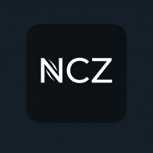
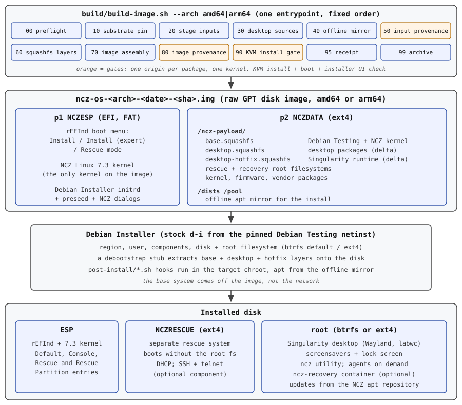

<p align="center">
  
</p>

<h1 align="center">NCZ-OS</h1>

> ### NCZ-OS 26.10 "Cygnus" Preview 4（2026-11-19）

> 从 [GitHub Releases](https://github.com/ncz-os/cix-installer/releases) 或
> [GitLab Releases](https://gitlab.com/ncz-os/cix-installer/-/releases/permalink/latest) 下载。
> · [发布说明和校验值（英文）](docs/releases/26.10-cygnus-preview4.md)
> · [已测试硬件](#hardware-support)
>
> 构建 `2026.11.19-4b51adc1`（`v26.10-preview4`）基于 Debian Testing（Forky）。
> amd64（Intel/AMD PC 与 Apple T2 Mac）和 arm64（CIX Sky1）各有 Desktop 和 Magnetar Server 镜像。
> 四个镜像均使用 Linux 7.4.0-rc3 候选版内核。安装前请先备份数据。

# cix-installer

> **🌐 语言：** [English](README.md) · 简体中文
>
> **📚 从这里开始：** [文档索引](docs/INDEX.md) · [26.10 发布说明](docs/releases/26.10-cygnus-preview4.md) · [设计理据 —— 为什么这样构建](docs/DESIGN-RATIONALE.md) · [AI/ML 技术栈参考](docs/AI-ML-STACK.zh-CN.md) · [源码发布](docs/SOURCE-RELEASES.zh-CN.md) · [下载镜像](https://github.com/ncz-os/cix-installer/releases)

**NCZ-OS Linux 发行版的安装程序与镜像构建。**

`make image` 生成可启动的**原始 GPT 安装镜像**（`ncz-os-<架构>-<日期>-<sha>.img`），
覆盖**两个一等目标架构**，共享同一条构建流水线与同一套用户态：

- **Arm64 — CIX Sky1**（Radxa Orion O6N、Minisforum MS-R1）。原生 Mali-G720 GLES
  （仅 Mali；Preview 4 未包含 Panthor）、Zhouyi V3 NPU、Linlon VPU —— 全部基于 CIX 的 DKMS
  加速器模块，运行在 NCZ Sky1 内核之上。
- **AMD64 — Intel/AMD PC 与 Apple T2 Mac。** Intel/AMD/NVIDIA 标准驱动在安装时从各家
  厂商真实、已签名的 apt 源接入；T2 Mac 上使用 NCZ T2 内核，Apple 固件与音频配置来自
  AdityaGarg8 的 `t2-ubuntu-repo`。

安装程序运行的是上游 **Debian Installer（d-i）**（取自 Debian Testing netinst，按架构以
内容哈希锁定，见 `manifests/base.pin`），并解压出预先构建好的 **Debian Testing（Forky）**
系统，再叠加与硬件匹配的内核、厂商用户态、Singularity 桌面与（可选加入的）NCZ agent 栈。

> Desktop 包含 2026-11-18 的 Singularity 快照及 NCZ-OS 补丁，
> 随附 NCZ Screensavers 0.8.22 和设置插件 0.3.27。
> Magnetar Server 需要有线网络，安装时会下载系统载荷并校验 SHA-256。
> amd64 的镜像约 0.6 GB，载荷约 3.3 GB，总计约 3.9 GB。
> arm64 的镜像约 1.0 GB，载荷约 3.8 GB，总计约 4.7 GB。
> Server 安装后以无图形界面的方式运行，提供文本控制台和 22 端口的 SSH。
> 控制台空闲 180 秒后会显示彩色 ASCII 黑洞屏保。

> ### 远程访问默认项
>
> NCZ-OS 面向的是**家庭用户、爱好者与实验台**，其默认设置也据此而定：**telnet
> （23 端口）**、2323 端口上的应急 root 控制台、允许口令认证与 root 登录的 SSH，
> 以及一个会在你的局域网上**占用独立 IP** 的恢复容器。它们的存在，是为了让一块刚被
> 你弄坏的板子仍然能被连上——这些机器很多是无头的，且没有可用的串口控制台。
>
> 在路由器后的家庭局域网上，我们不认为这构成实质暴露。**但在企业环境、共享网络，
> 或任何拥有可路由地址的场合，请关闭它们**——一条命令即可，见下文。
>
> **→ [docs/REMOTE-ACCESS.md](docs/REMOTE-ACCESS.md)** —— 究竟启用了什么、为什么，
> 以及如何逐项关闭。
>
> **→ [docs/RECOVERY-LOGINS.md](docs/RECOVERY-LOGINS.md)**（英文）—— 安装程序诊断登录
> （仅在安装程序运行期间存在，`root` / `rescue`，显示在每个控制台的启动横幅中）
> 与救援分区登录。

### 这个项目为什么存在，又为什么这样构建

简短版本：NCZ-OS 面向的是那些 **GPU、VPU、NPU 才是重点**的 ARM 系统——它不是"板级
支持包外加一个桌面"，也不是"把轻量桌面移植到新硅片上"。

这里每一个不那么显而易见的决定（GPU 栈、编解码路径、放弃 X/XFCE 改用 Singularity、
基础发行版、initramfs、发布节奏），都是对着真实 Sky1 硬件上的实测做出的。这些决定
及其证据都完整写在：

**→ [docs/DESIGN-RATIONALE.md](docs/DESIGN-RATIONALE.md)**

该文档中的论断都标注为 MEASURED（实测）、DECIDED（判断）或 OPEN（未决），因此你可以
基于证据而非口味来重新讨论它们。

## 设计上厂商中立

NCZ **在设计与意图上都是厂商中立的**。目标是：在能取得样机进行验证的前提下，支持
市面上出货的每一种 Arm 硅片系统，以及每一个主流 x86 平台。

**当前出货目标（两个都是一等目标——共享构建流水线、共享桌面、共享 agent 栈）**：

- **Arm64 — CIX Sky1 / CP8180** —— **Radxa Orion O6N** 与 **Minisforum MS-R1**，
  两者均在较早的版本中经过测试。这是 CIX 专有用户态（`libmali`、NOE、VPU 固件）以及三个
  DKMS 加速器模块（`mali_kbase`、`amvx`、`aipu`）接入之处（仅 Mali；Preview 4 未包含 Panthor）。其他 Sky1 主板
  （Orange Pi 6 等）尚未测试。仓库名反映的是历史，不代表项目范围。
- **AMD64 — Apple T2 Mac** —— 2018–2020 出货、搭载 T2 协处理器的 MacBookPro
  （15,1 / 15,3 / 16,1 / 16,2 / 16,3 / 16,4）与 MacBookAir（8,1 / 8,2 / 9,1）等机型。
  硬件识别通过 PCI `106b:1801` —— Apple T2 桥接设备 ID，正是 `t2linux` 的
  `linux-t2-patches` 所依凭的同一标识（已直接核对
  `9001-ACPI-x86-Apple-T2-systems-need-early-CPU-offlining.patch` 源文件）。在 T2 Mac 上，
  NCZ-OS 把 `apple-bce`、`applesmc`、HID 与 APFS 接入内核树（我们自己的 `7.4.0-rc3-t2-ncz` 内核），
  并在首次启动时从 AdityaGarg8 的真实、已签名 `t2-ubuntu-repo` 拉取 Apple 固件与音频配置。
- **AMD64 — 通用 x86-64 PC** —— 同一份构建、同一套用户态，无 CIX 栈。提供 Desktop 和 Server 镜像。与具体硬件绑定的加速器仓库（NVIDIA CUDA、
  AMD ROCm、Intel OpenVINO）由 `post-install/54-gpu-accel.sh` 中的 `lspci -nn`
  PCI 类自动检测并接入。没有独立显卡的机器会静默跳过，这是正常行为。

<a id="hardware-support"></a>

## 硬件支持与测试状态

> 在构建 `2026.11.19-4b51adc1` 上，arm64 Server 在 Radxa Orion O6N 上完成安装和首次启动。
> amd64 Server 在 Apple MacBookPro16,1（T2）上运行。amd64 Desktop 在 Apple MacBookPro16,1（T2）
> 和配有 NVIDIA GeForce RTX 2060 的 ASUS ROG Zephyrus M15 GU502LV 笔记本上进入桌面。
> 这些测试均无失败单元。两种架构的两个版本均通过了自动化虚拟机安装和启动检查。
> 在较早的 Preview 4 构建上，arm64 Desktop 在一块 CIX Sky1 主板上进入桌面。

以下是较早版本的 26.10 测试记录。

26.10 带有 **amd64 上的 AMD、NVIDIA 与 Intel GPU 驱动**、**CIX Sky1 上的 Arm Mali
驱动（厂商 Mali 栈；仅 Mali，Preview 4 未包含 Panthor）**，以及 **CIX Sky1 的 NPU 与 VPU**
驱动。我们实际运行过的机器：

| 机器 | CPU | GPU（驱动） | 测试结果 |
|---|---|---|---|
| Radxa Orion O6N | CIX P1（Sky1） | Arm Mali（厂商 Mali）+ NPU + VPU | 已安装，桌面、视频（VPU 硬件解码）与音频播放正常 |
| Radxa Orion O6 | CIX P1（Sky1） | Arm Mali（厂商 Mali）+ NPU + VPU | 社区测试者确认：桌面、应用与显示模式切换正常（由早期版本升级并更新了修复后的桌面库） |
| Minisforum MS-R1 | CIX P1（Sky1） | Arm Mali（厂商 Mali）+ NPU + VPU | 已安装，桌面、视频（VPU 硬件解码）与音频播放正常 |
| MacBookPro16,1（两台） | Core i9-9980HK、Core i7-9750H | AMD Radeon Pro 5300M/5500M 级（Navi 14，`amdgpu`）+ Intel UHD 630（`i915`） | 已安装，可启动到桌面 |
| ASUS ROG GU502LV 笔记本 | Core i7-10750H | NVIDIA GeForce RTX 2060 Mobile（专有 `nvidia`）+ Intel UHD 630（`i915`） | 已安装，可启动到桌面 |
| HP OmniDesk 台式机 | Core Ultra 7 265 | Intel 集成显卡（Xe-LPG，`i915`） | 已安装，可启动到桌面 |
| Dell Inspiron 5521（2013） | Core i7-3537U | Intel HD Graphics 4000（`i915`） | 已安装，可运行桌面 |
| Mac mini 2011（Macmini5,1） | Core i5-2415M | Intel HD Graphics 3000（`i915`） | 已安装，桌面正常（硬件加速图形） |

其他 GPU 与主板均未测试。视频、音频播放以及 VPU 硬件视频解码已在 Sky1 主板上验证；
其他 GPU 上的硬件视频解码取决于驱动。详细说明（Sky1 主板列表、T2 Mac 与通用 PC 的
分类、GPU 计算的硬件下限）见英文 [README](README.md#hardware-support--testing-status)。

## GPU 驱动与启动项

NCZ-OS **只发布一个 GPU 驱动**（仅 Mali，2026-11-16 操作员指令 "No panthor Mali only"）：
默认启动项上的 `mali_kbase`，提供 OpenGL ES 3.2、EGL 1.5，经 `libmali` 提供 OpenCL。
已在 Radxa Orion O6N 与 MS-R1 真机验证；桌面就跑在它上面。已移除的 Panthor 实验性启动项
（`panthor`，Mesa PanVK / rusticl）已在源码层面删除：没有任何启动项选择它，也不再发出
`sky1.gpu=mesa` 选项。

`mali_kbase` 独占 GPU；`panthor` 留在 `/etc/modprobe.d/ncz-gpu-drivers.conf`
黑名单中，永远不会绑定。

**代价。** `mali_kbase` 提供加速桌面，但**不暴露任何 Vulkan 入口**——`libmali`
本身就没有。Panthor 曾是通往 Vulkan 的路，但它已不再发布；Linux 7.4 之后再议。

### 每一个加速器驱动都是 DKMS 模块

这是一条刻意的规则，而非打包上的偶然：

| 加速器 | DKMS 包 | 模块 |
|---|---|---|
| GPU | `cix-gpu-kmd` | `mali_kbase` |
| VPU | `cix-vpu-driver` | `amvx` |
| NPU | `cix-npu-driver-dkms` | `aipu` |

**为什么用 DKMS 而不是内核内置。** 内核升级时 DKMS 模块会针对新内核重新构建；而以预编译
二进制形式随内核发布的模块被锁定在某一个 `vermagic` 上，内核一动它就会**悄无声息地**
不再加载——你会得到一个能启动、但加速器已死且毫无线索的系统。

它同时也让冲突可预测。当内核内置驱动与树外驱动同时匹配同一硬件时，DKMS 安装到
`updates/dkms/`，而 `depmod` 优先选择该目录，因此胜出的是我们期望的那个驱动，而不是内核
恰好编译进去的那个。内核内置的 `armchina_npu` 被彻底关闭（`CONFIG_ARMCHINA_NPU=n`）
也是同样的道理：厂商 26Q2 SDK 驱动比内核内置的更新，绝不能被后者遮蔽。

以上每一个驱动的对应源码都已发布 —— 见 [docs/SOURCE-RELEASES.zh-CN.md](docs/SOURCE-RELEASES.zh-CN.md)。

## 快速开始（在硬件上安装）

> **开机前请接好有线网络。** 安装程序中没有 Wi-Fi；若检测不到链路，安装程序会明确停在
> "Network autoconfiguration failed"（接好网线后选 Retry），而不是无声地重试。

1. **获取镜像。** 从 [GitHub Releases](https://github.com/ncz-os/cix-installer/releases) 或
   [GitLab Releases](https://gitlab.com/ncz-os/cix-installer/-/releases/permalink/latest) 下载所选架构和版本的 zstd 分片。
   每个分片小于 2 GiB。把分片、`PARTS-<arch>-<flavor>.sha256`、
   `SHA256SUMS-<arch>-<flavor>` 和 `ncz-join-image.sh` 放在同一个文件夹里。
   安装 `zstd` 后运行对应命令：

   ```sh
   sh ncz-join-image.sh amd64 desktop
   sh ncz-join-image.sh amd64 server
   sh ncz-join-image.sh arm64 desktop
   sh ncz-join-image.sh arm64 server
   ```

   脚本会校验分片，拼接并解压，再校验原始镜像。

2. **写入至少 16 GB 的 USB 驱动器。** 写入会清空该驱动器。Desktop 的 amd64
   镜像解压后约 7.2 GB，arm64 约 8.7 GB。可以使用 Balena Etcher。在 Linux 上，
   请确认设备名，并把下方命令中的镜像文件及设备名换成实际值。

   ```bash
   sudo dd if=ncz-os-amd64-20261119-4b51adc1-desktop.img of=/dev/sdX \
        bs=4M status=progress oflag=direct conv=fsync
   sync
   ```

   在 macOS 上先执行 `diskutil unmountDisk /dev/diskN`，再以 `/dev/rdiskN`（注意 `r`）
   为目标，并去掉 `oflag=direct`。

   > **`dd` 会毫不询问地写入你所指定的任何设备。** 执行前请用 `lsblk`（Linux）或
   > `diskutil list`（macOS）再确认一次目标；写错设备会销毁那块磁盘上的数据。

   > **只支持从 USB 驱动器安装。** 请把镜像写入 U 盘或 USB 硬盘，从它启动，再选择内置
   > 磁盘作为安装目标。把镜像写入内置 NVMe、SD 卡或 eMMC 并从那里安装不受支持。原因：
   > 安装程序只信任 USB 上的安装介质，这样介质检测更可靠，而且启动用的磁盘永远不会被
   > 安装程序清空。

3. **启动。** 把 USB 驱动器插到目标机器上（arm64 镜像用于 Sky1 主板，amd64 镜像用于
   Intel/AMD PC 或 T2 Mac），开机后从 UEFI 启动菜单选择该驱动器；Mac 上开机时按住
   Option（⌥）。安装程序在两种架构上都会启动 NCZ 内核（T2 Mac 上为 T2 内核）；若 Mac
   内置键盘在安装过程中没有响应，请准备一个 USB 键盘。

4. **回答安装程序的问题：**国家/地区（同时决定语言、时区与键盘）、用户名与密码（root
   登录关闭）、要安装的可选组件（桌面、恢复容器、救援分区，默认全选），以及目标磁盘与
   根文件系统：**btrfs**（默认）或 **ext4**。主机名会自动生成，可以修改。

5. 安装程序在确认页之后清空磁盘、完成安装并重启。拔掉驱动器后，系统经 rEFInd 启动到
   Singularity 登录界面；首次登录会显示一段桌面导览。

### 安装故障排查

- **"NCZ-OS installer: no USB installation drive found"。** 安装程序没有在 USB 驱动器上
  找到镜像。镜像被写入内置 NVMe、SD 卡或 eMMC，或 U 盘未被识别时会出现此界面。界面会
  列出在内置磁盘上找到的镜像（该磁盘不会被列为安装目标），新插入的 U 盘会在 10 秒内
  被识别；按 **R** 重新扫描 USB 端口，按 **S** 打开 shell，按 **B** 重启。把镜像写入 U 盘后插上即可继续安装，或从 U 盘重新启动。
- **收集日志。** 在安装程序主菜单中选择 **Save debug logs**，或按 Alt-F2 打开 shell，把
  `/var/log/syslog` 复制到 U 盘。Alt-F4 实时显示安装日志；Alt-F3 显示诊断控制台及远程
  登录信息（[docs/REMOTE-ACCESS.md](docs/REMOTE-ACCESS.md)，英文）。报告问题时请附上镜像
  文件名及其 `sha256sum`、失败的步骤，以及已安装系统上 `lsblk -f` 与 `sudo efibootmgr -v`
  的输出。
- **安装程序使用 rEFInd，而不是 GRUB。** d-i 自带的 GRUB 与 systemd-boot 步骤会被跳过，
  安装程序自己把 rEFInd 写入 ESP。目标机器上出现的 GRUB 提示来自其他系统或旧的启动项。

## 嵌入模型

模型**不在镜像中**——每个动辄数百 MB，而多数安装并不需要。安装完成后
`/opt/ncz/models` 是空的。

当你需要 NPU 推理时，从 apt 仓库安装其一：

```
sudo apt install ncz-model-nomic-embed   # 768 维，默认
```

在安装模型之前，NPU 推理会以 `noe_load_graph` 失败。**那是缺少模型，不是硬件或驱动
问题。** 模型说明见 [docs/MODELSCOPE-MODELS.md](docs/MODELSCOPE-MODELS.md)（英文）。

## 内核

Preview 4 每个镜像只带一个 Linux 7.4 内核。arm64（CIX Sky1）使用
`7.4.0-rc3-sky1-ncz`（+r303），amd64 使用 `7.4.0-rc3-t2-ncz`
（软件包版本 `7.4.0-rc3-4`）。默认、安装程序与救援启动项都使用同一个内核。
Linux 7.3 系列已停止维护。

对应源码见 [源码发布](docs/SOURCE-RELEASES.zh-CN.md)。

## 架构

Preview 4 为 amd64 和 arm64 各提供两个原始 GPT 磁盘镜像。
Desktop 随镜像提供基础系统，Magnetar Server 在安装时下载系统载荷。



**Desktop 镜像内容：**

| 分区 | 内容 |
|---|---|
| 1 — `NCZESP`（EFI 系统分区，FAT） | rEFInd 安装菜单（**Install**、**Install (expert)**、**Rescue mode**）、NCZ 内核，以及带 NCZ 预置（preseed）与对话框的 Debian Installer initrd。 |
| 2 — `NCZDATA`（ext4） | `/ncz-payload/`：`base`、`desktop`、`desktop-hotfix` 三个 squashfs 层及其叠加清单、静态 `unsquashfs`，以及安装时使用的资源（内核、固件、安装后钩子所需的软件包、救援与恢复容器的根文件系统、屏保插件）。`/dists` + `/pool`：安装使用的离线 apt 镜像。 |

`base.squashfs` 是带 NCZ 内核与固件的 Debian Testing（`forky`）根文件系统；`desktop.squashfs`
是桌面软件包的增量层；`desktop-hotfix.squashfs` 是 Singularity 桌面运行时（`/opt/singularity`）
的增量层。

**安装流程：**安装程序是各架构 Debian Testing netinst 中的**原版 Debian Installer**，按内容哈希锁定
（`manifests/base.pin`），本仓库没有手工修改的 d-i 源码树。NCZ 的改动在组装镜像时加入：我们的内核
替换 Debian 的安装程序内核（镜像中只有这一个内核，见 [docs/ONE-KERNEL.md](docs/ONE-KERNEL.md)）；
地区、用户、可选组件、磁盘与根文件系统等 NCZ 对话框（`preseed/*.sh`）；以及一个 `debootstrap`
替身（`build/iso/patch-debootstrap-stub.py`），d-i 调用 debootstrap 时由它把 squashfs 层解压到
目标磁盘。随后 `post-install/run-all.sh` 在目标 chroot 中运行编号的 `post-install/*.sh` 钩子，
apt 指向镜像上的离线镜像。Desktop 的少数可选组件（例如 NVIDIA 驱动）需要联网。Server 安装需要有线网络。

安装后的磁盘包含 EFI 系统分区（2 GB）、可选的 `NCZRESCUE` 救援分区（4 GB，ext4）和根文件系统：
**btrfs**（默认）或 **ext4**。

**安装后的系统：**

- **一个内核**，Linux 7.4。arm64 使用 `7.4.0-rc3-sky1-ncz`，amd64 使用 `7.4.0-rc3-t2-ncz`。默认、控制台与救援启动项都使用它。
- **Singularity 桌面**：基于 labwc 的原生 Wayland，greetd + Singularity 登录界面，KMS 启动画面
  取代 Plymouth。没有 X11 桌面会话；保留 Xwayland 运行 X 应用。
- **屏保与锁屏**（`ncz-screensavers`）：先启动屏保，之后再锁定会话。
- 每个窗口默认都有**最小化、最大化和关闭按钮**，对所有用户生效。
- **救援分区**：独立的救援系统，有自己的启动项，主根文件系统无法启动时仍可启动；按设计使用 DHCP，
  并提供 SSH 与 telnet。
- **恢复容器**（`ncz-recovery`，可选）：systemd-nspawn 容器，自带用户空间与 SSH。
- **`ncz` 工具**与预置的智能体 quadlet（默认均不启用），智能体按需用 `ncz` 安装。
- 从 NCZ apt 仓库获取**更新**。

**构建流水线**：唯一入口 `build/build-image.sh --arch amd64|arm64` 按固定顺序运行以下阶段，每个
阶段一份日志。来源检查在耗时阶段之前针对输入运行，坏的输入几分钟内就会失败。

| # | 阶段 | 作用 | 位置 |
|---|---|---|---|
| 00 | `preflight` | 检查主机、磁盘空间、工具与权限，拒绝在 tmpfs 上构建，检查基底与确定性锁定。 | `build/build-image.sh`、`build/check-substrate-pin.sh`、`build/gen-base-pin.sh --check` |
| 10 | `refresh-substrate` | `--substrate refresh` 获取最新的 Debian Testing netinst、校验签名并更新 `manifests/base.pin`；`--substrate pinned` 恢复并校验锁定的 netinst。 | `build/refresh-substrate.sh`、`build/stage-substrate.sh` |
| 20 | `stage-inputs` | 暂存按校验和锁定的构建输入、内核与屏保插件。 | `build/stage-build-inputs.sh`（`manifests/build-inputs.tsv`）、`build/stage-amd64-kernel.sh`、`build/stage-arm64-assets.sh`、`build/stage-screensaver-plugin.sh` |
| 30 | `refresh-sources` | 解析 Singularity 桌面源码（`--sources latest`）或复现已提交的锁定（`--sources pinned`），再构建或暂存桌面载荷软件包。 | `build/refresh-singularity-sources.sh`、`build/stage-singularity-payload.sh`、`build/build-singularity.sh`、`build/build-singularity-deb.sh` |
| 40 | `offline-mirror` | 构建放入镜像的离线 apt 闭包。 | `make offline-mirror` |
| 50 | `provenance-inputs` | 每个将进入镜像的软件包只能有一个来源：锁定的 Debian 快照、NCZ 构建或经审核的厂商软件包；不得出现 Debian 内核。 | `build/check-forky-provenance.sh`、`build/verify-no-debian-kernel.sh` |
| 55 | `static-gates` | 在任何层或镜像工作之前对锁定的源码树强制执行静态门禁套件：AMD64 NVIDIA CUDA 设计门禁（`build/test-amd64-cuda-gates.sh`，仅 amd64）与 greeter 控制台回退门禁（`build/test-greeter-console-fallback.sh`，两种架构）。失败即中止构建，不可跳过——`--resume-from` 的续跑点位于该阶段或其后时，会先重新运行套件而不是跳过，因此任何仍能产出镜像的运行都无法绕过它们。 | `build/test-amd64-cuda-gates.sh`、`build/test-greeter-console-fallback.sh` |
| 60 | `layers` | 构建并检查 `base`、`desktop`、`desktop-hotfix` 三个 squashfs 层。 | `build/layers-preflight.sh`、`build/build-squashfs-layers.sh all`（桌面软件包经 `build/build-role-delta-mkosi.sh`）、`build/check-layers.sh` |
| 70 | `image` | 用基底、内核、各层与离线镜像组装原始 GPT 镜像。 | `make image` → `build/build-installer-image.sh`、`build/iso/*.py` |
| 80 | `provenance-gate` | 对成品镜像再做一次来源与单内核检查。 | `build/check-forky-provenance.sh --image` |
| 90 | `kvm-gate` | 第 1 阶段在 KVM 中用镜像的一次性副本无人值守安装；第 2 阶段启动安装好的磁盘，出现意外失败的单元即失败；最后检查安装程序控制台界面。 | `build/kvm-install-gate-gpt.sh`、`build/kvm-installer-ui-check.sh` |
| 95 | `receipt` | 写入运行元数据与门禁摘要（不属于镜像内容）。 | 运行目录中的 `run-metadata.json` |
| 99 | `archive` | 仅当两道门禁都在本次运行中通过时，把镜像复制到 `NCZ_IMAGE_ARCHIVE` 指定的归档；`--no-publish` 时跳过。 | [docs/BUILD-SITE-CONFIG.md](docs/BUILD-SITE-CONFIG.md) |

## 构建镜像

构建步骤见英文 [README](README.md#quick-start-build-the-installer-image)。简要地说：
唯一入口是 `build/build-image.sh --arch amd64|arm64 --full --no-publish`（各阶段见上方「架构」一节）；只组装镜像时用
`make image ARCH=<arm64|amd64>`，结果为 `build/ncz-os-<架构>-<日期>-<sha>.img`。

**如实说明：** 目前无法仅凭公开来源完成完整的镜像构建。`manifests/build-inputs.tsv` 锁定的 44 个
预置输入中只有 6 个能从公开地址取得完全相同的字节（`build/stage-build-inputs.sh --arch <架构> --public`
会下载它们，并把其余输入列为仅限内部）；锁定的 Debian netinst 周构建镜像也已被上游替换。
所有 GPL 源码（包括两个内核）均已公开，详见 [docs/SOURCE-RELEASES.md](docs/SOURCE-RELEASES.md)。

<a id="upstream-work"></a>

## 上游贡献

以下工作起源于本项目，已进入上游或正准备进入上游。它们都不是 NCZ 专有的：
缺陷位于共享代码之中，因此修复应当回到各自的项目，而不是堆在发行版的补丁堆里。

### 浏览器与编解码：硬件视频解码

要让浏览器在这块硅片上真正用上硬件视频解码，需要给 CIX VA-API 驱动打六个补丁，另外还要
给 FFmpeg、Firefox 和 Chromium 打补丁。四个底层缺陷**全部是静默失败**——没有任何组件
记录过错误——这也是这项工作连同证据一起被写下来、而不是只留下修复的原因：

- **[docs/HW-VIDEO-DECODE-STATUS.md](docs/HW-VIDEO-DECODE-STATUS.md)** —— 哪些能用，
  验证方式是**看渲染出来的画面**而不是看某个代理信号。Chromium 中 H.264 1080p 与
  VP9 720p 走硬件解码（H.264 下渲染进程 CPU 由约 27% 降至约 3.5%）。AV1 在 VA-API 路线上受阻，但通过
  NCZ Chromium 版本中的 V4L2 解码器可以硬件解码。
- **[docs/upstream-patches/cix-vaapi/](docs/upstream-patches/cix-vaapi/)** —— 六个
  VA-API 补丁。没有它们，浏览器硬件解码在本平台上**完全不工作**。
- **[ffmpeg/](docs/upstream-patches/ffmpeg/)**、
  **[firefox/](docs/upstream-patches/firefox/)**、
  **[chromium/](docs/upstream-patches/chromium/)** —— V4L2 M2M 解码器支持、AV1 接线
  与时间戳处理。
- **[cix-vaapi-repro/](docs/upstream-patches/cix-vaapi-repro/)** —— 独立的 C 复现程序，
  让驱动作者不必构建浏览器就能确认每一个缺陷。


### Singularity 桌面

- **传感器面板插件** —— 面向 Sky1 的硬件传感器发现与分类。该平台呈现的是五个
  无标签的 ACPI 热区（`TZB0`、`TZB1`、`TZM0`、`TZM1`、`TZGT`），而不是其他平台
  上那块带标签的 SCMI 芯片。包含温度邻近匹配与限值来源标注，使每个读数都能被
  归到正确的设备。
- **网络接口组件** —— 枚举**每一个**以太网口（无论是否已连接），并给出检测到的
  芯片组与链路能力（如 2.5 GbE），而不是只列出活动连接。
- **Layer-shell 与会话修复** —— 在真实 Sky1 硬件上验证过的表面重建行为，以及
  一处 GSettings schema 修复：缺失的键会让进程 `SIGABRT`，而不是抛出异常。
- **平台识别** —— 通过 ACPI 硬件 ID（`CIXH*`）识别 CIX Sky1，而不是依赖 DMI
  厂商字符串——后者报告的是板卡厂商，而非 SoC。

## 致谢

NCZ-OS 几乎完全建立在他人的工作之上。下面大致按这些工作自内核向上堆叠的顺序排列。

**Linus Torvalds 与内核社区。** 先说最显而易见的一笔：没有内核，这一切都不存在。这里的
Sky1 使能（26.10 中为一个合并的移植补丁加 20 个编号补丁；26.7 中为 176 个补丁的系列）叠在三十年间数千人的工作之上；而一组厂商补丁系列**能够**
被这样承载、变基与公开发布，本身就是那个项目治理方式的产物。

还有一笔不那么显而易见、但值得直说的：本发行版是由一个人借助 AI 结对工具构建的。在业界
不少表态流于姿态的时候，Torvalds 对 AI 辅助开发的立场一直是务实的。他的总结——
*"AI is just a tool, like any other tool we use. And AI is clearly a useful tool"*
（AI 只是一件工具，和我们用的其他工具一样；而它显然是件有用的工具）——以及他对"Linux 是
一个反 AI 项目"这种框定的否定
（[lore.kernel.org](https://lore.kernel.org/linux-media/CAHk-=wi4zC+Ze8e+p3tMv8TtG_80KzsZ1syL9anBtmEh5Z40vg@mail.gmail.com/)），
确立了一条重要的准则：**评判补丁本身，而不是评判产出它的工具。**

他还提出了更锋利的一点：靠文档要求解决不了真正的问题——*"the AI slop people aren't going
to document their patches as such"*（真正在灌水的人，根本不会把补丁标注成那样）。这是对的，
也正因如此，本仓库的纪律落在**实测**而非**声明**上：这里每一条能力论断，背后都有真实硬件上的
一个负载；凡是没有实测过的，文档就明说没有。无论是什么产出了这些工作，它都应当按这个标准被
检验。

**Yocto 项目与 Linux 基金会。** Sky1 内核使用
**[Yocto 项目](https://www.yoctoproject.org/)** 构建——BitBake、OpenEmbedded 与
`poky`，CIX 使能则以 `meta-cix` 层的形式承载。那组补丁系列、它们的 `SRC_URI`
顺序、defconfig 以及可复现的部署产物，全都存在于这套模型之中。正是它让 26.7 时"一组 176 个
补丁的厂商系列跨四个上游基线反复变基"成为一个人而非一个团队能做的事，也正是它让我们
发布的对应源码**真的对应得上**。
**[Linux 基金会](https://www.linuxfoundation.org/)** 托管并维系着 Yocto，以及本发行版
所依赖的大部分周边生态。这类基础设施之所以容易被视为理所当然，恰恰是因为它一直在正常
运转；这种规模的项目不可能独自扛起它。

**CIX Technology。** CIX 的 SDK、Sky1 内核补丁系列与厂商用户态（`libmali`、NPU/VPU 栈）
是这块硬件能被编程的前提。他们把 Sky1 支持推向 Linux 主线的工作，意义超出本项目：这是
"一块永远需要厂商树的板子"与"一块最终能直接启动发行版内核的板子"之间的区别。有一点值得
直说：一家中国芯片厂商把使能工作推向上游、公开 SDK 并与社区互动，在这个行业里并非默认
选项，而在我们基于它构建的这段时间里，他们对开源的投入是肉眼可见地在改善。

**刘剑锋（[Jianfeng Liu](https://github.com/amazingfate)，`amazingfate`）。** Armbian
维护者，其跨 ARM 平台、以及具体针对 Sky1 的补丁与打包工作，为本项目省下了大量重复摸索。
如果你近几年在 ARM SBC 上跑过 Armbian，你就用过他的成果。

**Singularity —— Mirko Brombin 与 singularityos-lab 项目。** 桌面是
[Singularity](https://github.com/singularityos-lab)，由 **Mirko Brombin** 创建。
用它替换 XFCE/X11 是让这块硅片上出现真正加速桌面的关键一步，因为 Singularity 基于
labwc/wlroots，能原生抵达 Mali GLES，而不必绕道 Xwayland。

Mirko 也接纳了反向流动的改动。那些属于我们的工作，因此列在
[上游贡献](#upstream-work)一节，而不是放在这里。

**此外**：**Radxa**（Radxa Orion O6N，我们的主力开发与验证平台）、**Minisforum**
（MS-R1，本项目起步的那块板）、**Debian**（把 ARM 当作一等架构，这正是 26.7 建立在
Forky 上的原因），以及 **Mesa、wlroots 与 labwc**（开源图形与合成器栈）。

**t2linux 社区** —— 维护着让 T2 Mac 能在主线 Linux 上启动成为可能的 `linux-t2-patches`
系列。AdityaGarg8 的 `t2-ubuntu-repo`（通过 `apple-firmware-script` 提供的真实 WiFi/BT
固件、``apple-t2-audio-config`）让 AMD64 / T2 路径的 NCZ-OS 安装能跑出可用的桌面、而不是
只停在控制台。我们今天能有两台真 T2 MacBook 启动验证，都要归功于这些工作、而不是我们自己的。

**Apple 自己的 Asahi Linux 校友** —— `get-apple-firmware` 那台 macOS CDN 固件拉取器是
Asahi 衍生的工具，T2 固件钩子在调用它；没有它 T2 路径根本没有 WiFi/BT 固件可用。

**还有 Rachel。** 我的妻子。从这个爱好开始的第一天起，她就一直容忍着它——摊在餐桌上的
板卡、风扇的噪音、凌晨两点那句"再构建一次就好"。没有那份耐心，上面这一切都不会发生。

---

*本文档为英文 [README.md](README.md) 的中文版本。若两者出现分歧，以英文版为准。*

*同步状态（2026-10-13）：顶部横幅、引言、"硬件支持与测试状态"、"快速开始
（在硬件上安装）"、"内核"与"构建镜像"已按 26.10（2026-10-13 镜像）更新。其余章节仍是 26.7 时期的
译文，英文版中的"What's in 26.10"、"Architecture"、"OTA channel"、"The `ncz` utility"、
"Live recovery"、"Releases"等小节尚未翻译——请直接查阅 [README.md](README.md)。英文版始终是
规范版本。*
