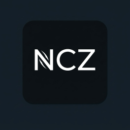

  

# Source releases — what we build, and where its source is

> **🌐 Language:** English · [简体中文](SOURCE-RELEASES.zh-CN.md)

NCZ-OS redistributes GPL/LGPL software and builds several components from
modified source. This page is the authoritative index of **everything in the
shipped image that we compiled ourselves**, with the source location for each.

If something we ship is built from source and is not listed here, that is a
bug in this document — please open an issue.

**GitLab is canonical for source** (`gitlab.com/ncz-os/cix-installer`).
Release images are on the one release page of each forge: the GitHub
mirror (<https://github.com/ncz-os/cix-installer/releases/latest>) and GitLab
(<https://gitlab.com/ncz-os/cix-installer/-/releases/permalink/latest>), with
the same files on both; see [IMAGE-HOSTING.md](IMAGE-HOSTING.md).
The source offer for the GPL code in an image lives in that release's notes,
in this document and in the git tags, which are kept for every release; it
does not depend on older release pages, which are removed when a new
release is published.

---

## Scope: what is ours vs what is the vendor's

| Category | Source obligation |
|---|---|
| Components **we** build from source (below) | **Ours.** Source published here. |
| CIX proprietary vendor `.deb`s (current reviewed ledger: 25 vendor originals in `manifests/vendor-debs.tsv` plus 1 NCZ-repacked NPU DKMS in `manifests/ncz-packages.tsv`; older releases shipped a larger set) | **Not ours.** Vendor-proprietary binaries redistributed under vendor terms. We do not hold or republish their source. The NCZ-repacked NPU DKMS carries our packaging recipe. |
| Stock Debian forky packages | Debian's. Available from `deb.debian.org` per Debian's own terms. |

---

## Components built from source in 26.10 "Cygnus"

Images `ncz-os-arm64-20261013-d395bb2d` and `ncz-os-amd64-20261013-d395bb2d`.
Versions are taken from the reviewed NCZ build ledger,
[`manifests/ncz-packages.tsv`](../manifests/ncz-packages.tsv), at commit
`d395bb2d`.

| Component | Shipped version | License | Source |
|---|---|---|---|
| **Linux kernel, Sky1 (arm64)** | `7.3.0-rc7-sky1-ncz` (package `linux-image-cixmini` `7.3.0-rc7-sky1-ncz+r289`) | GPL-2.0 | Mainline v7.3-rc7 plus the Sky1 port patch and 20 numbered patches. Vendored in [`kernel-source/`](../kernel-source/SOURCE.md); recipe tag `kernel-sky1-7.3.0-rc7-r289` in [`ncz-os/meta-cix`](https://gitlab.com/ncz-os/meta-cix); the complete patched tree is tag `kernel-sky1-7.3.0-rc7-r289-src` in [`ncz-os/linux-cix`](https://gitlab.com/ncz-os/linux-cix). See **Kernel corresponding source** below. |
| **Linux kernel, amd64 (T2 Macs and PCs)** | `7.3.0-rc7-t2-ncz` (package `7.3.0-rc7-2`) | GPL-2.0 | Mainline v7.3-rc7 plus the t2linux patch series and our T2 fixes (24 patches), in [`ncz-os/linux-t2-ncz`](https://gitlab.com/ncz-os/linux-t2-ncz), tag `v7.3.0-rc7-t2-ncz-2`. See **Kernel corresponding source** below. |
| **cix-installer** (installer, preseed, post-install hooks, build scripts) | commit `d395bb2d` | see repo | **This repository**, commit `d395bb2d`. |
| **cixmini-boot** | `1.2+r289` | GPL-2.0 | Boot/firmware glue for Sky1 boards, built by `build/build-kernel-debs.sh`. |
| **ncz-ffmpeg** (arm64) | `9.0.1-ncz3` | LGPL-2.1+/GPL-2+ | FFmpeg with Sky1 V4L2 M2M support; patches under [`docs/upstream-patches/ffmpeg/`](upstream-patches/ffmpeg/). |
| **chromium-ncz-sky1** (arm64) | `154.0.8037.0-ncz20261011` | BSD-3-Clause + others | Chromium with Sky1 V4L2 decode fixes; patches under [`docs/upstream-patches/chromium/`](upstream-patches/chromium/). |
| **ncz-singularity-desktop** | built per image from pinned upstream commits | see upstream | Singularity desktop (labwc/wlroots) from `singularityos-lab`, with our packaging and the patches under [`assets/singularity/patches/`](../assets/singularity/patches/). |
| **ncz-screensavers**, **ncz-screensavers-plugin** | `0.8.13`, `0.3.21` | see upstream | NCZ screensaver engine and its Singularity settings page. |
| **libgtk4-layer-shell0** (patched, arm64) | `1.3.0-1+ncz20261013` | MIT | gtk4-layer-shell 1.3.0 (`e8704f4`) plus the patches under [`packaging/gtk4-layer-shell/patches/`](../packaging/gtk4-layer-shell/patches/); built by `packaging/gtk4-layer-shell/make-deb.sh`. |
| **libdrm** (patched) | `2.4.134-3+ncz2` | MIT | Debian libdrm plus `libdrm-xf86drm-acpi-platform-identity.patch` (in `docs/upstream-patches/`). |
| **DKMS accelerator packages** | `cix-gpu-kmd-dkms 1.0+ncz2`, `panthor-cix-dkms 7.2.0+ncz2`, `cix-vpu-driver-dkms 1.0.2-ncz1+ncz2`, `cix-npu-driver-dkms 6.2.0-cixdeb13-260714+ncz3` | GPL-2.0 | DKMS packages ship their module source in the package itself (`/usr/src`); the same source is in `assets/kernel/{mali,panthor,vpu,npu}/` here. The prebuilt `.ko` overlays for the shipped kernel are bound to that source by `assets/kernel/*/7.3.0-rc7-sky1-ncz/SOURCE.sha256`. |
| **Patched d-i udebs** | `debootstrap-udeb 1.0.145`, `apt-setup`/`partman-*`/`mdcfg`/`nobootloader` `+ncz1` | GPL | Debian sources plus the patches recorded for each row in `manifests/ncz-packages.tsv`. |

### Kernel corresponding source

Every part below was fetched anonymously (no account, no token) on
2026-10-13 with `git ls-remote` or `curl`.

**arm64, `7.3.0-rc7-sky1-ncz` build r289**

| Component | Where | Revision | License |
|---|---|---|---|
| Upstream base | `https://git.kernel.org/pub/scm/linux/kernel/git/torvalds/linux.git` | tag `v7.3-rc7`: commit `24a19b953e2a3d0ea5a8c4951a0ab8f32720c907` (tag object `ec8bf828…`, the value of the recipe's `SRCREV_kernel`) | GPL-2.0 |
| Recipe, Sky1 port patch, patches 0001-0011 and 0013-0021, defconfig | [`ncz-os/meta-cix`](https://gitlab.com/ncz-os/meta-cix) `recipes-kernel/linux-cix-sky1-ncz/linux-cix-sky1-ncz_7.3-rc7.bb` | tag `kernel-sky1-7.3.0-rc7-r289` (branch `fix/sky1-r289-20261012`), commit `6b6b55aa13a877ff8083592048f0a6043703c26a` | GPL-2.0 (patches), Apache-2.0 (recipe) |
| The same, vendored, plus the as-built `.config` (sha256 `67bb7109…`) | [`kernel-source/`](../kernel-source/SOURCE.md) in this repository | this commit | GPL-2.0 |
| Complete patched source tree as one commit | [`ncz-os/linux-cix`](https://gitlab.com/ncz-os/linux-cix) | tag `kernel-sky1-7.3.0-rc7-r289-src`, commit `b275222cfc5703fb5595398a216b495ca7d6ee7a` (branch `release/sky1-7.3.0-rc7-r289`) | GPL-2.0 |
| Debian packaging (`linux-image-cixmini`, `linux-headers-cixmini`, `cixmini-boot`) | `build/build-kernel-debs.sh` in this repository | commit `d395bb2d` | see repo |
| Out-of-tree modules `mali_kbase`, `memory_group_manager`, `protected_memory_allocator` | `assets/kernel/mali/src` (CIX `cix_opensource__gpu_kernel`) | commit `d395bb2d` | GPL-2.0 |
| Out-of-tree module `panthor` (Sky1 fork) | `assets/kernel/panthor/` | commit `d395bb2d` | GPL-2.0 OR MIT |
| Out-of-tree module `amvx` (VPU) | `assets/kernel/vpu/src` (CIX `cix_opensource__vpu_driver`) | commit `d395bb2d` | GPL-2.0 |
| Out-of-tree module `aipu` (NPU) | `assets/kernel/npu/src` (CIX `cix_opensource__npu_driver`) | commit `d395bb2d` | GPL-2.0 |

The recipe's `SRC_URI` fetches the port tree from a local mirror; the public
copy is `ncz-os/linux-cix` branch `kernel-73rc7-port-20261011`
(`e53244ff…`). Applying the port patch to the base gives exactly that branch's
tree; applying all 21 patches in `SRC_URI` order gives exactly the tree of the
`kernel-sky1-7.3.0-rc7-r289-src` commit.

**amd64, `7.3.0-rc7-t2-ncz` package `7.3.0-rc7-2`**

| Component | Where | Revision | License |
|---|---|---|---|
| Upstream base | `https://git.kernel.org/pub/scm/linux/kernel/git/torvalds/linux.git` | tag `v7.3-rc7`: commit `24a19b953e2a3d0ea5a8c4951a0ab8f32720c907` | GPL-2.0 |
| Patch series (24: t2linux apple-bce, applesmc, HID, APFS and Touch Bar patches plus our T2 fixes), resolved config, build and packaging script, `verify.sh` | [`ncz-os/linux-t2-ncz`](https://gitlab.com/ncz-os/linux-t2-ncz) | tag `v7.3.0-rc7-t2-ncz-2`, commit `35249a98c7ad2f07cf2d0055a3be3c0c40f5b506` | GPL-2.0 |
| T2 DKMS modules `t2smc`, `t2gmux` (built by default), `t2thunderbolt` (opt-in), `t2smp` (shipped, never built) | `assets/kernel/t2smc/`, `t2gmux/`, `t2thunderbolt/`, `t2smp/` in this repository | commit `d395bb2d` | GPL-2.0 |

`linux-t2-ncz` is a clean export of the development repository. Applying its
`patches/series` to the base gives git tree `451b5dfe…`, and its config is
byte-identical (sha256 `e88c4505…`) to `/boot/config-7.3.0-rc7-t2-ncz` in the
shipped package. The shipped `linux-image` and `linux-headers` packages are
also in the public NCZ apt repository with the same sha256 as the build
record (`36ed84e7…`, `81f18202…`).

### Installer initrd and other GPL binaries

* The installer is Debian's d-i from the pinned Debian snapshot. The amd64
  installer initrd gets our kernel and modules (`build/iso/patch-initrd-t2-kernel.py`,
  source as above) and firmware files (`build/iso/patch-initrd-firmware.py`).
* `debootstrap-udeb 1.0.145` is patched by `build/iso/patch-debootstrap-stub.py`
  (the patch is that script). The `+ncz1` udebs (`apt-setup`, `mdcfg`,
  `nobootloader`, `partman-*`) are unmodified Debian sid sources rebuilt with a
  version suffix by `build/rebuild-sid-udeb.sh`; their sources are on
  `snapshot.debian.org` at `20261005T120000Z`.
* `assets/diag/busybox-amd64` and `busybox-arm64` (the installer's diagnostic
  console, staged by `build/iso/stage-ncz-payload.py` and, on amd64, baked into
  the installer initrd) are the unmodified `usr/bin/busybox` of Debian forky
  `busybox-static` `1:1.38.0-3+b1` (amd64 and arm64) from the pinned snapshot
  `20261012T023456Z`; deb and binary sha256 are pinned in
  `manifests/diag-busybox.tsv` and checked by `build/stage-diag-busybox.sh`.
  Source: <https://snapshot.debian.org/package/busybox/1%3A1.38.0-3/>.

### Rebuilding an image: what you can fetch

The GPL source above is complete. Rebuilding a byte-identical image is a
different matter: `build/build-image.sh` also consumes 44 pre-staged inputs
pinned by sha256 in [`manifests/build-inputs.tsv`](../manifests/build-inputs.tsv),
and most of them are not downloadable.

| Inputs (rows in `build-inputs.tsv`) | Count | Can a stranger fetch the exact bytes? |
|---|---|---|
| CPython 3.11 and `uv`, both arches | 4 | **Yes.** GitHub release URLs in [`manifests/build-inputs-public.tsv`](../manifests/build-inputs-public.tsv); sha256 checked. |
| `ncz-screensavers` 0.8.13, both arches | 2 | **Yes.** Public NCZ apt repository; sha256 checked. |
| Recovery and rescue root filesystems | 4 | No. Rebuild with `build/build-mgmt-rootfs.sh` / `build/build-rescue-rootfs.sh` at the pinned snapshot; the output is not byte-reproducible. |
| Artist Pack wallpaper packages | 8 | No. The apt repository has `1.0` builds with different bytes; rebuild with `build/build-wallpaper-contrib-deb.sh`. |
| Patched libdrm `2.4.134-3+ncz2` | 22 | No (the apt repository has only `+ncz1`). Rebuild with `build/build-libdrm-debs.sh` (Debian source plus the patch in this repository). |
| `chromium-ncz-sky1` 154.0.8037.0-ncz20261011 | 1 | No. Source is public in [`ncz-os/chromium-ncz-sky1`](https://gitlab.com/ncz-os/chromium-ncz-sky1). |
| CIX vendor package bundle, Sky1 firmware tree, NPU DKMS package | 3 | No. Vendor-proprietary binaries and firmware we are not able to republish as a bundle; the NPU DKMS package's GPL source is inside the package. |

Other inputs:

* **Debian Installer substrate** (`manifests/base.pin`): the pinned Debian
  testing netinst images came from `cdimage.debian.org/cdimage/weekly-builds/`,
  which replaces them every week. The pinned sha256 no longer matches what that
  URL serves, so the exact substrate cannot be fetched today.
* **Debian packages**: the pinned snapshot `20261012T023456Z` on
  `snapshot.debian.org` is public.
* **Kernels**: the amd64 kernel packages are in the public apt repository
  (same bytes). The Sky1 r289 packages are not published there; rebuild them
  from the source above.
* **Desktop payload** (`manifests/singularity-payload.tsv`): both
  `ncz-singularity-desktop` packages are in the public apt repository with the
  pinned sha256.

`build/stage-build-inputs.sh --arch <arch> --public` downloads the six public
inputs, checks them against the pins, and lists every input it cannot fetch as
`INTERNAL-ONLY`. A full image build from public sources alone is **not**
possible today; we have not tested one.

## Components built from source in 2026.08.18-v12 (26.7, historical)

| Component | Shipped version | License | Source |
|---|---|---|---|
| **Linux kernel** | `7.2.0-sky1-ncz` | GPL-2.0 | **[`kernel-source/`](../kernel-source/SOURCE.md) in this repository** — a complete corresponding-source drop: 286 patch files (176 wired into `SRC_URI`), the defconfig, and the pinned upstream SRCREVs. **See "Kernel source" below.** |
| **cix-installer** (the d-i installer, preseed, post-install hooks, build scripts) | `2026.08.18-v12` | see repo | **This repository.** Tag `v2026.08.18-v12`. The installer *is* its own source release. |
| **ncz-ffmpeg** | `6.6+20260608-2` | LGPL-2.1+/GPL-2+ | Modified FFmpeg with Sky1 V4L2 multiplane support. Patch shipped in-tree at `docs/upstream-patches/ffmpeg-v4l2-multiplane.patch`. |
| **chromium-ncz-sky1** | `151.0.7922.75-ncz20260808` | BSD-3-Clause + others | Chromium with Sky1 build/runtime fixes. |
| **ncz-singularity-desktop** | `9.0.1-ncz3` | see upstream | Singularity desktop (labwc/wlroots), upstream `singularityos-lab`, with our packaging + fixes. |
| **cixmini-boot** | `0.29-3+b1` | GPL-2.0 | Boot/firmware glue for Sky1 boards. |
| **libdrm** (patched) | in `docs/upstream-patches/` | MIT | `libdrm-xf86drm-acpi-platform-identity.patch`. |

### Kernel source

The kernel is the component with the most substantive GPL obligation, because
we ship a modified binary kernel in every image.

* Upstream pristine bases are published as generic packages
  (`linux-pristine-base-cix-sky1-ncz`), so the exact unmodified starting tree
  can be obtained and diffed.
* Our patch series is applied in `SRC_URI` order — **not** filename order —
  by `build/port-series.sh`, which validates that every patch wired in the
  recipe actually applies (176/176 for the 7.2 series).
* A prior source drop could **not** rebuild the shipped kernel: 171 of 176
  patches were wired and 5 files were absent. That is fixed; the validator
  exists specifically so it cannot regress silently.

### Where the kernel source actually is

**In this repository, under [`kernel-source/`](../kernel-source/SOURCE.md).**
That directory is the corresponding source for the shipping kernel: 300 files
(9.3 MB), 286 patch files of which **176 are wired into the recipe's
`SRC_URI`**, the 7.2 lean defconfig (`config-7.2-lean-*.defconfig`), and the pinned upstream
base revisions with their kernel.org shas. It does not depend on the GitLab
package registry.

The generic packages `linux-source-cix-sky1-ncz` (`7.0.12`, `7.2-rc5`) and the
`linux-pristine-base-*` tarballs in the package registry are **supplementary**
— they let you fetch a pristine upstream tree without cloning kernel.org, and
they cover binaries distributed by earlier releases.

> **Open item for 2026.08.18-v12 — version-string mismatch.**
> `kernel-source/SOURCE.md` documents `KERNELRELEASE = 7.2.0-rc7-sky1-ncz`,
> but the shipped ISO reports `7.2.0-sky1-ncz` (`KVER_NEXT`). The source tree
> is the right one; the recorded release string is stale. Reconcile the two so
> a recipient can match the binary they have to the source they downloaded
> without having to infer it.

---

## Kernel channels — current reality

NCZ-OS 26.10 ships **one** kernel per image (`7.3.0-rc7-sky1-ncz` on
arm64, `7.3.0-rc7-t2-ncz` on amd64); the default, installer and rescue boot
entries all use it. There is no edge channel. The paragraphs below describe
26.7, which shipped `7.2.0-sky1-ncz`.

The older `7.0.12-cix-sky1-next` channel has been **removed from the ISO**. It
is not a fallback, not a rescue kernel, and not selectable from the boot menu.
Verified on the v12 image: `assets/kernel/` contains only `edge`, there is no
`KVER_LEGACY`, and no file on the ISO references 7.0.12.

Its source and pristine base remain published only because binaries built from
them were distributed in earlier releases, and GPLv2 §3(b) obliges us to keep
that source available to anyone who received those binaries.

---

## Requesting source

Everything in the source tables above is downloadable without an account. If
you received an NCZ-OS binary and cannot find its corresponding source here,
open an issue at <https://gitlab.com/ncz-os/cix-installer/-/issues> or write to
Jason Perlow `<jperlow@gmail.com>`; we will publish it.

**Written offer.** This offer is valid for three years from the date of distribution, to any third party, for no more than the cost of physically performing source distribution: we will provide the complete corresponding machine-readable source of the GPL/LGPL components of any NCZ-OS binary we distributed. To ask, open an issue at <https://gitlab.com/ncz-os/cix-installer/-/issues> or email jperlow@gmail.com.
