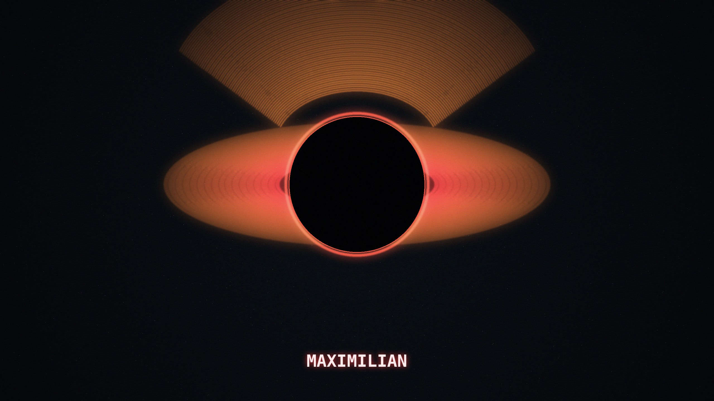

  

# NCZ-OS 26.7 "Maximilian" — installer 2026.08.27-v14

Arm64 Linux for CIX Sky1 boards, with the GPU, NPU and VPU actually working.

| | |
|---|---|
| ISO | `nclawzero-installer-cixmini-2026.08.27-v14.iso` |
| md5 | `40af9351f4e072e3d77b0ad324de0bac` |
| size | 3.9 GB |
| kernel | `7.2.0-sky1-ncz` |
| base | Debian forky (testing), arm64 |
| desktop | Singularity (labwc / wlroots, native Mali GLES) |

A maintenance release on top of [v13](2026.08.18-v13.md). Same kernel, same
drivers. Fixes a stale-content shipping bug in the desktop panel, and closes
the build-pipeline gap that let it happen.

## Sensor panel: two-column layout and neutral clock color restored

A prior build shipped an out-of-date `ncz-singularity-desktop` payload: the
sensor/system panel was missing its two-column layout for long detail lists,
and rendered the clock/temperature readout in the accent color instead of a
neutral one (visible as unexpectedly red text depending on theme).

Root cause: two independent local source lineages of the same panel-fixes
work existed on the build host, and a version-stamping gap in
`build-singularity-deb.sh` meant a rebuild from the wrong lineage produced the
same package version string as a prior, correct build — so the staleness
check saw "already published" and skipped republishing. Fixed content now
verified directly from the shipped `.deb` inside this ISO (not from the
version string): two-column layout, neutral `text_color` clock rendering, and
the monitor-resolution screenshot fix are all present in
`pool/main/ncz-singularity-desktop_20260827+bk3~gcorrectedtwocolumn1_arm64.deb`.

## Reproducible squashfs builds

`mksquashfs` was producing a different output hash for byte-identical staged
input — the superblock's own creation-timestamp field is not covered by
`-all-time`, and default multi-threaded packing can reorder blocks
non-deterministically. Both are now pinned (`-all-time 0 -fstime 0
-processors 1`), verified by building the same input twice and comparing
sha256 (byte-identical). This is what let the stale-content bug above go
undetected as long as it did: a version-string match looked like proof of
"unchanged," and a squashfs hash mismatch on an actually-unchanged rebuild
looked like corruption instead of build noise.

## vainfo added to the desktop image

`vainfo` (VA-API diagnostics) ships alongside the existing `mesa-utils` /
`vulkan-tools` GPU diagnostic set.

## Hardware validation (Radxa Orion O6N)

Verified on real hardware, this build, this exact `.deb`:

- **GPU** — Mali-G720-Immortalis enumerates via both Vulkan and OpenCL 3.0
  (vendor `mali_kbase` driver; `panthor` remains deliberately blacklisted,
  unrelated to this release — see prior notes on ACPI enumeration).
- **NPU** — full 3-core probe (`zhouyi-v3`), `/dev/aipu` present.
- **VPU / VA-API** — CIX media driver loaded, H264 decode + encode
  entrypoints present.
- **Audio** — `cixsky1` ALSA card, 3x I2S devices bound.
- **USB, network** — peripherals and primary NIC enumerate normally.

## Build-pipeline hygiene

The manual local-source-tree workflow that produced the stale-lineage bug
above is retired for this class of fix; the version-stamping and squashfs
determinism fixes make a silent repeat of this specific failure mode
structurally harder, independent of which workflow authored the change.
