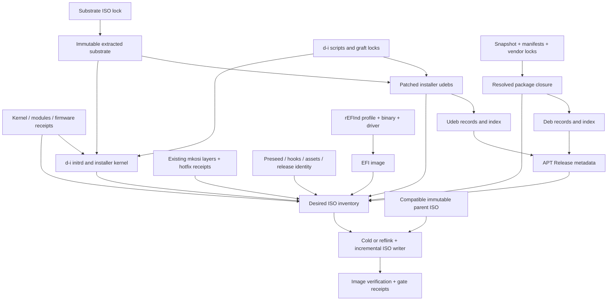

# Incremental d-i ISO assembly

**Status:** design proposal; no production builder changed. Prepared for the
2026-09-21 build incident. Repository examined: `b83a41d23ee7b4ccb19fd11da7be982afa19cd84`.
The operator's live-build observations are input evidence, not measurements
repeated by this design exercise. No prior-attempt/history search was repeated.

## 1. Decision

Replace `build/build-iso-di.sh` with a content-addressed assembly graph and a
transactional ISO writer. Keep the working mkosi layer producers, the
base/desktop/hotfix layer shape, and the real Debian Installer runtime.

Use xorriso as the low-level ISO writer, with two explicitly different operations:

1. **Cold assembly/compaction:** construct a complete image from immutable,
   independently cached components.
2. **Warm assembly:** reflink a compatible previous image, map only changed files
   and remove obsolete logical paths, grow its ISO filesystem, and explicitly
   re-emit the EFI partition. Verify the resulting layout before publication.

The second operation is the proposed seconds-scale path. Caching an extracted
tree followed by `xorriso -as mkisofs` on every invocation is insufficient: it
still copies the multi-gigabyte payload. Neither `-indev old -outdev new` nor
`-boot_image any replay` alone establishes an incremental bootable-image writer.

**Qualification:** the warm writer is a prototype-backed design, not a validated
Sky1/T2 media implementation. A small local experiment demonstrated reuse of
unchanged extents and preservation of an explicitly re-emitted EFI partition;
it also exposed a GPT/padding issue. Firmware, d-i media discovery, and real
installation validation are release-blocking milestones below.

No new mkosi bootable-image configuration is required. mkosi retains its current
job producing layers. Making mkosi the final image formatter would not itself
solve ISO block reuse or preserve this project's NCZ customisations on top
of the stock d-i runtime (the grafted udebs in the initrd, the cixmini payload
staging, the debootstrap-udeb install-time stub — see §3 "Hard contracts" —
NOT a patched d-i source tree). A pinned assembly container may package
xorriso and the other tools; it is not a new installed OS or live-initrd
design.

The performance promise is **a newly assembled bootable candidate in seconds for
an eligible small hotfix**, on a qualified local reflink filesystem, once the
package is built. It is not a promise to compile arbitrary source changes or
complete a fresh install-boot gate in seconds. A changed release candidate still
requires its full install-boot test before release. An identical previously
verified artifact can reuse that exact artifact's valid test receipt.

## 2. Evidence and discrepancies that affect the design

These are source observations, not reasons to override the operator's constraints.

| Evidence in this checkout | Design consequence |
| --- | --- |
| `build/build-iso-di.sh:794` onward deletes staging and extracts the substrate on every run; later code rebuilds both package indexes, hashes the staged tree, and rewrites the ISO. | Introduce caching before extraction, udeb transforms, package indexing, asset placement, and formatting. Replacing only Step 7 cannot deliver the requested result. |
| `build/build-iso-di.sh:953` onward grafts Trixie debootstrap/zstd-related udebs and subsequently rewrites several udebs. | The substrate is more than a kernel/initrd pair. Preserve these transformations and their compatibility dependencies. |
| `build/build-iso-di.sh:1056` onward replaces debootstrap in full mode; the live stub applies base, desktop, and hotfix payloads. `docs/ISO-BUILD-GUARDRAILS.md` identifies the separate `preseed/extract-rootfs.sh` path as a historical dead-code twin. | Extract the **live** implementation into a versioned input; do not accidentally promote the dead twin to authority. |
| `build/build-iso-di.sh:2502` onward replaces the installer kernel/modules for arm64, but retains the substrate's kernel on amd64. | Separate installer-kernel and installed-kernel identities. An amd64 installed-kernel promotion need not invalidate the d-i initrd. |
| `build/build-iso-di.sh:3509` onward generates GRUB configuration; Step 7 uses the substrate's `boot/grub/efi.img`. `post-install/70-bootloader.sh` selects rEFInd for both installed architectures. | The inspected **media** path still differs from the standardized installed bootloader. The replacement must build rEFInd media explicitly, with a qualification milestone, rather than claim rEFInd media parity already exists. |
| `Makefile:37` onward defaults to a pinned testing/arm64 netinst and argues for matching Forky. Its cited `docs/ISO-REBAKE-TYDEUS-2026-08-21.md` reports phase 1 passing but phase 2 failing. | There is evidence of testing-d-i experimentation, not sufficient evidence here of a successful current real-Sky1 qualification. Do not silently adopt that default or treat the comment's PASS claim as a complete result. |
| The builder's header describes a Debian-to-Ubuntu pivot, while `release.conf` selects Forky and full mode installs prepared layers. No `full-upgrade`/`dist-upgrade` invocation was found in the inspected `preseed/` and `post-install/` trees. | The supplied two-stage description and current full-mode implementation are not literally identical. Preserve the Bookworm d-i/Forky-target boundary and actual layer installation. Do not add an unnecessary Bookworm target installation and upgrade to full mode based on an old comment. Reconcile the live invocation and any separate pivot path before cutover. |
| `release.conf` pins `NCZ_BASE_MIRROR_SNAPSHOT=20260920T203924Z`; `build/build-forky-mirror.sh` passes the expiry exception to APT. `post-install/23-base-apt-sources.sh` writes the snapshot URI without a `Check-Valid-Until: no` field. | Carry snapshot policy into all consumers; test expired pinned metadata in the target environment as well as the build environment. |
| `build/build-squashfs-layers.sh` has `build_singularity_payload()` and `build_hotfix()` as separate functions; the public `hotfix` action invokes a fresh source build first. | The seconds-scale figure applies to hotfix materialization from a ready `.deb`, not necessarily the entire existing command. Keep the mechanism; add a producer/assembly boundary without disguising compilation time. |
| `sbom/expected-assets-amd64.txt` explicitly documents the fixed-hash/fresh-head conflict. | Replace manual expected-output edits with pinned input policy plus generated producer and assembly receipts. |
| The amd64 KVM gate extracts and fully repacks a GRUB test copy; it checks default boot reaching userspace. The arm64 gate only warns when its root-mode marker is absent. `make iso-verified` currently names the arm64 gate directly. | Gate integration needs real changes: architecture routing, rEFInd-aware test configuration, incremental test copies, and explicit acceptance assertions. |

The named `Kernel-build-checklist.md` was not located in the checkout or the
searched local Claude tree. Its rules supplied in the brief are binding here:
preserve rescue/fallback entries, use dracut for target kernel/module changes,
and never archive a live root with `tar -C /`. Obtain the complete checklist for
implementation review; this document does not claim to have audited unseen rules.

## 3. Hard contracts

* **Architectures:** explicit `arm64/sky1` and `amd64/pc-t2` profiles. No host
  architecture inference at assembly time and no shared mutable `forky-mirror`
  output across architectures. Shared `Architecture: all` blobs are permitted;
  dependency resolution and indexes remain architecture-specific.
* **Installer runtime:** initially pin the operator-accepted Bookworm d-i input
  separately for each architecture by ISO digest, with all grafts also pinned.
  Sky1 retains real d-i BusyBox init and the proven hardware workarounds. No
  casper, subiquity, or systemd live-initrd substitution.
* **Installed OS:** Forky from the deliberate snapshot, existing mkosi layers,
  existing overlay manifests and install/post-install behavior. Bookworm is
  installer provenance, never the target distribution label. If a supported
  mode actually installs Bookworm then pivots, preserve and test that transition;
  do not route it to live Debian mirrors. Full layered mode retains its existing
  prepared-Forky installation route.
* **Boot:** rEFInd on both media and installed systems in the replacement. UEFI
  only. Keep architecture-specific kernel paths and hardware options as data;
  common bootloader choice does not imply identical kernels or command lines.
* **Recovery:** retain all declared safe, diagnostic, rescue-partition, and
  known-good fallback entries and their required payloads. Add or explicitly
  disable entries; never delete them during kernel promotion or compaction.
* **Kernel updates:** match image, modules, headers, firmware and DKMS provenance;
  regenerate the target initramfs with dracut after relevant changes and before
  updating ESP copies. Preserve required early cpio ordering, including applicable
  NPU overrides. The d-i BusyBox initrd is a different artifact: retain its init
  and update its module/tool/firmware overlays, not replace it with dracut.
  Bake-time dracut runs in the intended staged target environment with explicit
  KVER, module tree, firmware and configuration, never the build host's default
  kernel. Preserve required install-time regeneration for the target's actual
  storage setup. Do not copy a stale initrd into the ESP after rebuilding modules.
* **Offline repair:** preserve the complete resolved `.deb` closure and the real
  installer `.udeb` set. Layer presence never justifies pruning reinstallable
  packages. One replacement `.deb` must agree with every installed/staged copy.
* **Filesystem safety:** assembly consumes files and immutable trees, never the
  live host root. Any privileged staging has an explicit disposable root,
  validated archive paths and symlink policy. No `tar -C /`; no writes through
  hardlinks into shared cache objects.

## 4. Proposed components and interfaces

Names below are proposed new files, not existing commands.

| Component | Responsibility / current code replaced |
| --- | --- |
| `build/assemble-di-iso.py` | Main planner, node keys, locks, receipts, publication, `--explain`; replaces monolithic orchestration. Python suits structured manifests and dependency checking; tools remain subprocesses. |
| `build/iso/profiles/{sky1-arm64,pc-t2-amd64}.json` | Explicit substrate lock, installer paths, kernel roles, payload mappings, required rescue entries and hardware settings. Full/thin/netinstall modes are separate declared inputs. |
| `build/iso/import-substrate.sh` | One verified extraction per substrate digest; inventory original boot files, `.disk`, udebs and initrd. Replaces Step 1 extraction without touching the imported tree afterward. |
| `build/iso/build-di-runtime.sh` + `build/iso/di/` | Declarative udeb transforms, live debootstrap stub, BusyBox/initrd overlays, branding, storage detection, tool/firmware injection. Replaces inline patch/heredoc machinery. Each transform declares its own inputs. |
| `build/iso/build-package-repository.py` | Wrap existing resolution behavior with a versioned lock; maintain per-archive package records, separate deb/udeb indexes, Release metadata and complete-closure checks. Uses `build/build-forky-mirror.sh` logic without its mutable global output convention. |
| `build/iso/stage-payload.py` | Produce an explicit destination inventory for preseed, late hooks, cloud-init, layers, overlay manifests, kernels, rescue, firmware, management assets and branding. Replaces Step 4 bulk-copy logic. |
| `build/iso/build-refind-esp.sh` | Deterministic per-architecture FAT ESP and shared menu generator. Replaces reliance on the substrate's GRUB ESP/configuration. |
| `build/iso/write-image.py` | Cold xorriso writer and qualified warm writer; safe clone, changed-path list, explicit ESP re-emission, GPT/El Torito validation, final layout receipt. Replaces Steps 6–7 with cached file checksums and transactional output. |
| `build/iso/verify-image.py` | Validate actual image namespaces, boot structures, inventory, package indexes, layer manifests and provenance, independently of staging paths. |
| `build/iso/run-gates.py` | Architecture dispatch and content-bound gate receipts; adapts existing gate scripts rather than discarding their behavioral checks. |

The existing `build-role-delta-mkosi.sh` and squashfs builders remain producers.
Add small machine-readable receipts to their successful outputs; do not change
their filesystem layering, dpkg-status handling, whiteout/opaque semantics or
root-mode rules. A narrowly scoped internal entry point can materialize a hotfix
from an explicitly selected `.deb` digest without invoking compilation twice.

Conceptual graph:



Suggested CLI, for review of behavior:

```text
assemble-di-iso.py plan --profile pc-t2-amd64 --inputs release-inputs.json --explain
assemble-di-iso.py build --profile pc-t2-amd64 --inputs release-inputs.json --output out.iso
assemble-di-iso.py verify --artifact <artifact-id> --level release
assemble-di-iso.py compact --artifact <artifact-id> --output compact.iso
```

`plan` reports changed real inputs and affected nodes, not merely “cache miss.”
`build` publishes a complete candidate atomically. `verify` records stronger
evidence for that candidate. `compact` creates another physical artifact; it is
not permitted to inherit a previous ISO's boot-layout validation automatically.
Neither a filename nor a `latest` symlink is an artifact identity.

## 5. Content keys and the no-change contract

For each node:

```text
node_key = SHA256(canonical_encoding(
    schema_version, node_kind, architecture, mode,
    recipe_and_transitive_helper_digests,
    relevant_effective_configuration,
    toolchain/container_digest,
    ordered_input_artifact_digests))
```

Directory identities include sorted relative path, type, content hash or symlink
target, mode, ownership and relevant xattrs. Include removals, executable-bit
changes, empty directories where significant, dirty tracked files, required
untracked inputs and gitignored assets. Do not use `mtime`, filename, `.deb`
version, KVER, “file exists,” or Git HEAD alone as staleness detection. Preserve
order where it is semantic: layer stack, patch series, initrd cpio members,
kernel command line. Canonical JSON alone must not accidentally sort such lists.

Key only the release fields a node consumes. A branding change invalidates
branding/configuration, not the Forky resolver; a snapshot change invalidates the
resolver and dependent layers. During initial extraction from the shell monolith,
conservatively hash the whole script until helper dependencies have been made
explicit. Broader temporary invalidation is safer than missing an input.

Resolve shell/environment overrides into an allowlisted effective configuration
before planning (including `DIAG_ENABLE`, substrate override, suite, asset roots,
mode and explicit version). Include external helper/configuration bytes where
consumed; reject undeclared overrides. After input resolution/import, assembly
has no network dependency and cannot consult a host APT configuration or silently
select a different asset directory. Record the source of every effective value
in `--explain` output.

Proposed store:

```text
build/iso-cache/v1/
  blobs/sha256/<digest>
  nodes/<arch>/<kind>/<key>/{receipt.json,inventory.json,...}
  images/<physical-id>/{image.iso,layout.json,receipt.json}
  gates/<gate-key>/result.json
  locks/
```

Each producer writes to a unique temporary directory, hashes outputs, validates,
then atomically publishes the complete object and receipt under a per-key lock.
Failed or interrupted nodes never become cache hits. Image publication uses
fsync and rename on the same filesystem; old candidates remain immutable.
Independent architecture jobs and build-pool hosts cannot share mutable workdirs.
Garbage collection follows references from retained releases and active jobs.

### Avoiding a hidden multi-gigabyte hash pass

A digest written next to a freely mutable file is not reliable cached evidence.
Import unmanaged large files by hashing them; publish them into protected,
immutable content-addressed storage. Producers and consumers use object IDs,
not arbitrary writable paths. Local read-only snapshots/controlled store
permissions support reuse within the trusted builder boundary. Rehash blobs
when imported from another host or untrusted storage; corruption scrubs remain
available. Privileged changes to supposedly immutable objects invalidate this
trust model and require verification, not timestamp shortcuts.

Mutable repository inputs are rehashed. Large objects already sealed by the
pipeline can use their validated digest receipts. On a legacy workspace without
that boundary, correctness requires reading those bytes again, and the planner
must report that cost. No “near-instant” claim applies to hashing arbitrary
multi-gigabyte mutable assets from scratch.

### Source freshness versus immutable build inputs

Resolve a requested moving source ref to a commit **before** making a build key;
record recursive submodule commits, patch bytes, toolchain, flags and source
tree digest. Then build from that immutable lock. A new upstream head invalidates
the package producer even when downstream packaging filenames did not change.
An offline repeat explicitly consumes a previously resolved lock and does not
claim to have checked today's upstream head.

The existing “always rebuild from head” policy is not silently removed by this
proposal. Assembly can reuse unchanged output bytes even if that producer still
runs every time. Reusing source-build results for an unchanged resolved commit
requires adopting this receipt-based policy explicitly during implementation.
An explicit fresh-source-build action remains supported. A nondeterministic
fresh rebuild that changes bytes is a real input change, not a cache hit.

### Artifact identity and determinism

Use a stable content-derived build ID by default. Explicit `--version`, release
labels, diagnostic options and stamped identity are inputs. Do not embed the
current host, wall clock or invocation counter on every rerun; place operational
timestamps in external receipts. Use a locked `SOURCE_DATE_EPOCH`, sorted inputs,
fixed compression options, normalized cpio/tar metadata, deterministic gzip,
FAT identifiers/dates, xorriso volume dates and GPT GUID policy.

An identical request returns the existing image and exact same bytes, without
an xorriso run. Cross-host cold reproducibility is a qualification test, not an
assumption about today's scripts. A warm image retains historical extents and
can differ physically from a cold image of the same logical contents. Record
both the logical inventory digest and physical identity (parent physical ID,
writer recipe and changed ranges). Cache hits return a previously recorded
physical artifact; no claim of history-independent warm-image bytes is made.

## 6. Package repository: cheap updates without an incomplete pool

Separate three products:

1. **Closure lock:** package name, exact Debian version, architecture, repository
   origin, archive SHA-256/size, control metadata and selected dependencies.
2. **Archive blobs and cached records:** per-`.deb`/`.udeb` records keyed by
   archive bytes and scanner version. Filenames include a digest-qualified path
   so two different files with the same nominal version cannot collide.
3. **Indexes:** deterministic sorted composition of cached records, compressed
   Packages, component Release/translation metadata where needed, suite Release
   checksums and signing policy. Preserve the current logical media paths such
   as `dists/forky/main/binary-amd64` and `.../debian-installer/binary-amd64`.

The repository writer runs `dpkg-scanpackages` or equivalent field extraction
only for changed archives. Concatenating about 1,672 cached deb stanzas and
recompressing a small Packages index is acceptable; unpacking or rehashing all
package archives is not. Udeb index inputs are independent of application deb
inputs. Release generation must enumerate only intended index files, use a fixed
date and exclude the previous Release/InRelease from self-hashing.

A small local package update uses the existing locked closure as its baseline.
Check its complete relationship metadata (`Pre-Depends`, versioned `Depends`,
`Provides`, `Conflicts`, `Breaks`, `Replaces`, architecture and Multi-Arch), and
run an APT simulation against cached locked indexes with the proposed package.
An unchanged dependency result permits one archive/record replacement and small
index updates. Do not assume that unchanged package name or unchanged `Depends`
text alone proves this. Modified relationships or reverse-dependency failure
trigger resolution and any required new downloads/layer rebuilds.

On a manifest change or snapshot bump, resolve the complete closure again and
regenerate its indexes. Reuse verified blobs by digest where possible; “full
regeneration” means recompute the package set and metadata, not deliberately
redownload identical archives. Upstream deb closure regeneration does not itself
invalidate Bookworm udebs or the imported substrate.

`release.conf`'s snapshot is mandatory for release builds. Record signed upstream
Release/InRelease and Packages digests and the archive keyring identity. Pin
vendor/desktop repositories too, using immutable manifests and exact archive
digests; a pinned Debian mirror plus a mutable local vendor directory is not
reproducible. Resolve and download exact versions from those locked indexes.
No fallback to a newer live mirror after a snapshot fetch failure.

The snapshot expiry exception must be scoped to snapshot sources and retained
in APT, mmdebstrap, mkosi inputs and any target/pivot source. Signature checking
remains enabled for upstream archives. Test the actual generated `.list` or
deb822 syntax; for the latter explicitly generate `Check-Valid-Until: no` where
required. Snapshot age is a separate freshness-policy result, never permission
to silently move the pin. Expiry/freshness policy can change release eligibility
without rebuilding identical image bytes.

Keep local-media trust policy explicit. If local indexes are signed, signing
and key identity are inputs; secret keys stay outside the ISO. If existing
trusted local-media semantics are retained, do not describe generated hashes
as independent authentication.

## 7. Change classes and expected invalidation

| Change | Rebuild/update | Reuse | Warm assembly objective / escalation |
| --- | --- | --- | --- |
| Ready Singularity `.deb`, same dependency closure and supported hotfix layout | Hotfix squashfs + opaque manifest; changed `.deb` in repair pool and every selected asset location; package record, deb index, Release, file checksums and provenance | Base, desktop, substrate, d-i runtime, udeb index, kernel and usually ESP | Target 2–15 seconds on qualified local NVMe/reflink storage for roughly 12 MB hotfix plus package bytes and small ESP; measure, do not assert as achieved. Compilation and fresh VM testing are additional. |
| Other package/patch | Changed consumer nodes; eligible isolated payload or role layer; corresponding repair pool/index | Components not consuming that package or patch | Not every patch is hotfix-safe. libc, dpkg status, dependencies, maintainer scripts or baked hooks can require base/role rebuilds. No generic “all patches cost seconds” claim. |
| Sky1 installer/target kernel promotion, modules or firmware | Applicable kernel package records, target dracut output, installer module cpio/initrd, boot payloads/menu when needed, ABI/kernel receipts | Imported Bookworm tree, unrelated udebs, unchanged upstream package records and layers | Work proportional to changed kernel/module/initrd bytes and actual DKMS work; no base extraction or full deb scan merely because KVER changed. If kernel content is baked into a layer, that layer is a real dependency. |
| amd64 installed-kernel promotion | Stable/edge target package/assets, dracut outputs and boot configuration; kernel tests | Stock installer kernel/initrd unless separately changed, substrate and unrelated package indexes | Keep T2 stable and edge/fallback roles explicit. Never substitute a target KVER into d-i implicitly. |
| Base/desktop manifest or Forky snapshot | Complete closure resolution/index generation; affected mkosi producers and coherence checks; compose/reseal image | Same substrate and unaffected installer components; identical archive blobs | Legitimate larger build. Changed base identity invalidates every dependent desktop delta; hotfix eligibility is re-established against the resulting stack. |
| Preseed/late hook/cloud-init/configuration | Payload files plus any baked consumers; install-gate receipt | Substrate, pool and layers unless the changed hook actually ran at layer build time | Usually a small assembly update; installer behavior changes still need full qualification. |
| d-i patch or udeb graft | Affected udebs/initrd overlay, udeb records/index and Release | Application layers, independent deb records | Test against the literal pinned d-i BusyBox runtime. |
| No effective input change | Nothing; return existing immutable artifact; re-evaluate requested gate/freshness policy | Everything | Target under one second to a few seconds for local receipts and small source hashes. No extraction, resolver, producer, xorriso or whole-ISO hash pass. |

These are graph consequences, not a manually selected “cache/no-cache” switch.
The planner identifies cross-class changes. A “desktop patch” that also updates
a boot hook is both changes. Unknown inputs fail planning or conservatively
invalidate their consumers; they never default to reuse.

Hotfix acceptance retains `opaque opt/singularity`, layer root mode 0755,
capabilities, exact layer order and base/desktop compatibility. Verify the
installed dpkg version agrees with the selected new `.deb`, and a repair/reinstall
from the ISO installs the same bytes. A raw file overlay alone does not execute
maintainer scripts, update dpkg status or resolve new dependencies. Preserve the
existing package-install path that reconciles these; strengthen its gate rather
than inventing a general package overlay mechanism in this project.

Prefer a new Debian package version for every changed locally published payload.
The cache must still detect same-version byte changes, but APT can consider an
already-installed same-version package satisfied. Such replacements require an
explicit selected-archive reinstall and byte verification, or fail release
policy; a new cache key alone does not make APT apply the patch.

## 8. Media layout and the incremental writer

### rEFInd media layout

Retain `/install.a64/` and `/install.amd/`, `/cixmini/`, `.disk`, `pool/` and
`dists/` so installer consumers do not need a new storage protocol. Generate
an ESP with `EFI/BOOT/BOOTAA64.EFI` or `BOOTX64.EFI`, rEFInd configuration,
required icons and the matching ISO9660 EFI filesystem driver.

Preferred layout keeps the ESP small and loads the EFI-stub installer kernel
and d-i initrd from the ISO filesystem. Use explicit entries and volume/path
selection rather than depending on rEFInd's automatic scan ordering. This is a
design choice requiring real firmware testing, especially ISO discovery when
the hybrid image is presented as USB storage. rEFInd documents both ISO9660
filesystem drivers and EFI-stub boot support; that establishes the mechanism,
not compatibility with this particular Sky1/T2 layout.
([rEFInd drivers](https://www.rodsbooks.com/refind/drivers.html),
[rEFInd Linux boot methods](https://www.rodsbooks.com/refind/linux.html))

If that layout does not qualify, keep rEFInd and place the same kernel/initrd
inside FAT. The ESP then becomes substantially larger and must be rewritten
on every growing update; report that cost honestly. Large FAT El Torito images
need their own firmware/loading qualification. Do not silently fall back to
GRUB or abandon d-i. Preserve the current GPT slot/alignment conventions unless
hardware evidence supports a deliberate change.

Render graphical install, SAFE/rescue and DIAG entries from one architecture
profile. Preserve the existing graphical-versus-serial distinctions and relevant
Sky1 USB/SMMU/ACPI options; do not mechanically translate contradictory comments
into new command lines. Explicitly record the tested command-line bytes. Avoid
rewriting the ESP merely to stamp a new invocation time; installer build identity
comes from the locked manifest. If an explicit build version must be in a menu
or command line, it is a real ESP input.

### Warm writer transaction

1. Verify the parent receipt and immutable-storage boundary. Require matching
   architecture, media schema and compatible boot layout. Acquire a publication
   lock and clone into a private temporary image with `cp --reflink=always`.
   Never edit the parent or a published artifact. Reflink support is tested on
   the actual output filesystem, not inferred from its name.
2. Compare the parent's **logical inventory** with the desired one using content
   identities. Enumerate additions, replacements and removals. Do not use
   timestamp-based `xorriso -update_r` discovery. Protect all fallback/rescue
   inventory paths from implicit removal.
3. Map changed files with native xorriso commands, reuse existing extents for
   unchanged files, and remove obsolete logical paths. Write commands as safe
   structured arguments/quoted command files, never shell-interpolated paths.
4. Explicitly supply the external immutable ESP image to `-append_partition` on
   **every growth**, plus the qualified GPT/alignment settings. Recreate or keep
   the El Torito reference according to its actual digest. `keep` is valid only
   when the catalog's referenced EFI image is unchanged; an EFI change must
   explicitly select the new image. Until that branch is qualified, an ESP or
   media-layout change uses cold composition from cached components.
5. Parse the resulting primary and backup GPT, entry arrays/CRCs, protective MBR,
   ISO volume descriptors and El Torito catalog independently. Verify partition
   and file ranges, non-overlap where required, correct EFI architecture and
   exact ESP bytes. Validate both ISO-internal and appended EFI copies if the
   layout uses two. Never trust xorriso's exit status alone.
6. Handle trailing output padding explicitly. A qualified finalizer may truncate
   beyond the backup GPT **only after** proving that all referenced ISO, boot and
   partition extents end within the retained range and the removed bytes are
   permitted padding. Otherwise fail or cold-compose; do not guess the end
   from file size or blindly run a partition repair command. Re-parse and
   validate the final primary/backup GPT including reciprocal LBAs and CRCs.
7. Verify changed-file hashes by reading the actual image, check all paths and
   Release/index links, update image block/file inventory receipts, fsync and
   atomically publish. An interrupted write leaves only disposable temporary
   output; the parent remains bootable and unchanged.

The xorriso documentation distinguishes growing (`-dev`) from rewriting
(`-indev`/`-outdev`) and warns that subsequent sessions overwrite appended
partitions. That is why explicit ESP handling is part of the writer contract.
([xorriso manual](https://www.gnu.org/software/xorriso/man_1_xorriso.html))

The intended warm operation is equivalent in shape to the following **prototype
sketch**, not a production command to run against an existing release:

```text
reflink parent.iso -> private-candidate.iso
xorriso -dev private-candidate.iso
        -boot_image any keep
        -append_partition 2 0xef immutable-esp.img
        -boot_image any appended_part_as=gpt
        -boot_image any partition_cyl_align=all
        -map changed-hotfix /cixmini/desktop-hotfix.squashfs
        ...explicit changed mappings and obsolete-path removals...
        -commit -end
validate/finalize geometry; verify image contents; publish atomically
```

### Local experiment and what it did not prove

The design exercise used xorriso **1.5.8.pl02**, libisofs/libisoburn/libburn
1.5.8, with a tiny synthetic ISO, an 8 MiB unchanged file, a roughly 1 MiB dummy
EFI payload and successively replaced 1/2/3 MiB files. The dummy payload was not
a FAT filesystem or executable bootloader: this was strictly a layout experiment.

| Observation | Result |
| --- | --- |
| Naïve `-dev` growth with `keep` and no re-appended EFI image | New filesystem data began at the old appended partition's location; unsafe. |
| `-dev` growth with `-boot_image any replay` on the imported appended layout | Failed: `Multi-session would overwrite imported_iso interval`. |
| Explicit external `-append_partition` with GPT/alignment options | Three consecutive updates succeeded; appended payload hashes matched. |
| Unchanged 8 MiB file | Remained at LBA 547 through all three updates. |
| Primary GPT header and entry-array CRCs | Matched after each explicit-ESP update. Backup header signatures were present; this was not a full backup-CRC validator. |
| Cold image EOF | Immediately after the backup GPT. |
| Three grown image EOFs | Each had 360,448 bytes beyond the GPT-declared end; needs qualified finalization. |
| Reflink capability | Workspace reports Btrfs; the `/tmp` experiment filesystem rejected `cp --reflink=always`. Toy experiments then used ordinary copies. No production reflink latency was measured. |

This rules out simplistic recipes and supports the proposed extent-reuse path.
It does **not** prove rEFInd, kernel EFI-stub handoff, firmware partition scanning,
mount behavior, repeated production-sized growth, determinism, or the performance
objective. Implementation milestone 1 must test these before fast artifacts can
be released. Do not present this synthetic image as a boot test.

### Limits, compaction and distribution

Growing retains unreachable old payloads. Set an explicit policy, initially
compact after 20 updates or 15% dead-byte overhead, then tune with measurements.
Those are operational defaults, not correctness constants. Cold composition
reuses every valid component cache; it does not mean rebuilding the world.
Removed confidential content requires compaction before distribution because
removing a logical filename does not erase its old extents.

Warm and cold outputs are ordinary self-contained `.iso` files; reflink sharing
is a host storage optimization, not a runtime dependency on the parent. Plain
copying, uploading or writing the entire ISO to USB still costs O(image size).
No delta-download service, writable live-media protocol or external payload
dependency is required by this design.

If reflink is unavailable, report a normal full clone or cold composition with
the same component caches. Never silently claim the fast-path SLO was met.
Do not introduce fixed-size hotfix slots or custom ISO directory-record patching
unless native xorriso growth fails qualification; those alternatives add capacity
and parser risks without evidence they are needed.

## 9. SBOM, checksums and provenance

Separate **policy inputs**, **producer evidence**, and **observed output**:

* Version-controlled policy specifies required asset roles, architectures,
  accepted source identities, reproducible build recipes, static external
  artifact locks and required gates. Keep exact hashes for deliberately fixed
  externally supplied assets.
* A producer receipt binds resolved source/patch/toolchain inputs to actual
  output SHA-256 and size. Assembly accepts the selected receipt, not whatever
  file happens to sort last in an assets directory.
* Assembly emits an inventory/SBOM of what actually entered the image, including
  layer order and base-parent identities, package closure, kernel bundles,
  installer substrate/grafts, firmware, rEFInd and configuration digests.

The preflight gate checks that required objects exist, match their producer
receipts and satisfy the policy. The post-assembly gate verifies the image
against those independent inputs. Computing hashes from an arbitrary staged
directory and immediately declaring those same hashes “expected” is not enough.
Unknown/missing provenance fails closed or requires an explicitly imported,
hash-pinned artifact; a changed source-built desktop does not require manually
editing `expected-assets-amd64.txt` after every successful build.

Cache per-file SHA-256 and compatibility MD5 at object creation. Regenerate
`md5sum.txt` by composing stored records for the current path inventory,
rehashing only changed files. Keep MD5 as d-i compatibility metadata, not an
integrity policy substitute. Exclude the checksum file from its own list;
also explicitly exclude formatter-generated boot catalogs from that compatibility
list, while validating them in the external layout receipt. Otherwise updating
the checksum file can regenerate the catalog and create another checksum change.
Check that the actual d-i media checker accepts this declared exclusion policy;
test it on a grown image. Hash boot structures after formatting in the external
receipt, without another ISO write.

Avoid cycles: the embedded content manifest does not contain the final ISO hash
or its own checksum. An external assembly receipt binds that manifest and the
physical artifact. A full conventional SHA-256 of a changed 6.4 GB ISO requires
reading the entire byte stream; it cannot be updated from the old digest plus a
hotfix. Compute it during release finalization/asynchronously, then bind gate
results to it. A verified block-Merkle map can provide a fast internal identity
using inherited immutable ranges and newly hashed blocks, but it is explicitly
**not** the conventional whole-file SHA-256. No-op requests reuse the already
known final hash. Remote transfers always verify content on receipt.

## 10. Validation and release eligibility

Build speed and validation coverage are separate. Keep candidates usable for
iteration, with an external status of `assembled`, `smoke-passed` or
`release-verified`; do not stamp an ISO as release-verified before the gate runs.

| Gate | Inputs and when it runs |
| --- | --- |
| Required-asset/SBOM preflight | Proposed replacement for fixed generated-output entries in `preflight-sbom-check.sh`; checks selected producer receipts and profile every plan. Retain required package, udeb, rescue and firmware coverage. |
| `dkms-abi-gate.sh` | Run for changed applicable kernel/header/DKMS bundles before packaging. Add exact producer bundle identity, config, Module.symvers and module content hashes. The current builder/compiler matching is useful but not proof that two artifacts came from one build. Skip only in a profile with no applicable DKMS, not because its arch is assumed never to have DKMS. |
| `kvm-kernel-gate.sh` | Retain Sky1 config collision lint and boot test keyed to image/config/tool environment. It is arm64-specific and deliberately permits the expected missing-root panic: do not describe it as a successful full userspace boot. Add an amd64 counterpart for each shipped target kernel; the existing default-kernel install gate does not test every fallback kernel. |
| d-i/runtime static tests | Exact transformed udeb contents and literal scripts under the pinned d-i BusyBox via `test-under-di-busybox.sh` adapted to digest-keyed initrd extraction. Preserve root-mode, manifest and extraction consistency checks; retire the twin check only when one executable source is actually established. |
| Package closure and layer gates | Existing offline-pool, seed/version, squashfs readability/root-mode and overlay checks. Incremental record/object verification for local candidates; independent complete reading/checking at release or untrusted import. Include install simulation and same-package repair/reinstall. |
| New image-layout gate | Every changed image: GPT/MBR/El Torito, EFI architecture and hashes, logical inventory, deleted paths, package Release links and current layer chain. Also verify rEFInd entries and all referenced rescue files. |
| New media boot smoke | Boot the produced media via OVMF/AAVMF from fresh NVRAM through rEFInd to the d-i start/media-discovery marker. Exercise raw USB-storage presentation and virtual optical media; neither `-kernel` nor merely extracting files tests this chain. |
| `kvm-install-gate-amd64.sh` / `kvm-install-gate.sh` | Full fresh install and boot, routed by profile, mandatory for every changed release candidate. Cache only a passing receipt for the same immutable artifact and gate/environment/policy inputs. Never transfer a full-install PASS from yesterday's ISO to a new desktop hotfix. |
| Real hardware qualification | Sky1 O6N/cixmini boot/media discovery and relevant GPU/storage/USB behavior; T2 and representative PC firmware/default and fallback boot. Mandatory for new media/boot/runtime architecture and relevant kernel changes. QEMU does not model Sky1's accelerator ABI hazards or all T2 firmware behavior. |

Gate receipt keys include subject artifact/content IDs, gate script and test
configuration digests, QEMU/firmware versions, machine model, acceleration/CPU
profile, relevant host environment, timeout and acceptance-policy version.
Failed, partial, timed-out or “warning only” results are not a reusable PASS.
Allow an explicit force-test action without forcing component rebuilds.

### Adapting the full install gate

Initially retain the known scripts for reference, but remove their repeated
full extraction/rebake using the same image writer on a private test clone.
Generate the unattended rEFInd entry/preseed patch through the common profile
renderer. Record the parent production digest, the exact test delta and the test
ISO digest. Validate that only declared test configuration changed. Never publish
credentials or unattended destructive settings into the production image.

A test copy is not literally the shipping image. Pair its full install with a
smoke test of the **unmodified** release menu/boot chain, including the graphical
entry; a serial-only gate must not hide the console regressions documented in
this repository. Longer term, an external test-input channel can avoid image
changes, but that is optional and requires explicit d-i support.

After installing, boot without installer media and require assertions beyond a
generic systemd banner: expected Forky release, locked package/kernel identities,
configured dpkg state, root mode 0755, the expected hotfix files and removed old
files, dracut/module consistency, rEFInd default/fallback references, and rescue
partition readiness. Check ordinary boot and selected fallback entries. In a
separate repair check mount the media and reinstall the changed package from
its offline pool. Tests should demonstrate the latest patch actually arrived.

The advertised offline install path must work with external network access
disabled; optional online actions need explicit skip/fixture policy. A networked
VM that happens to repair missing packages from the Internet is not evidence
of a complete offline ISO. Use fresh VM disks/NVRAM for full install qualification;
reusing an already installed VM is a useful targeted package test, not its
equivalent.

## 11. Delivery sequence and acceptance tests

1. **Qualify the writer and rEFInd boot layout first.** Pin the toolchain; create
   a minimal real rEFInd/d-i image for each arch. Test explicit-ESP growth and
   final geometry after repeated updates, including a changed boot payload,
   different-size hotfixes and file removal. Boot as optical media and raw USB
   in QEMU and on the actual target classes. If it fails, keep cold composition
   as the documented interim; do not advertise seconds-scale final assembly.
2. **Extract components with behavior parity.** Move the live d-i transforms and
   explicit payload map into the new graph. Keep old builder output as a logical
   parity oracle. Compare file inventories, patched udebs/initrd contents,
   architecture exclusions, recovery entries, package closure, command lines,
   layer ordering and target behavior. Differences such as rEFInd media must
   be intentional and separately tested. No simultaneous layer redesign.
3. **Introduce immutable imports and producer receipts.** Seal substrate,
   package/layer/kernel assets and toolchain inputs. Replace generated-output
   hardcoded SBOM hashes only when source policy and producer verification are
   wired up; never temporarily turn off the gate.
4. **Incremental indexes and image updates.** Add per-package records, desired
   inventory deltas, image transactions, checksum reuse and `--explain`.
   Qualify base/desktop/hotfix coherence and all architecture-specific mappings.
5. **Integrate gates and Make targets.** Make `iso` invoke the planner unconditionally
   so Make timestamps cannot bypass content checks. Make `iso-verified` route
   by profile and require all release receipts. Keep the old script as an
   explicitly selected interim backend until equivalent full tests pass on both
   architectures; then turn it into a compatibility wrapper or retire it.

Required regression/performance cases:

* Same inputs twice: same artifact bytes/ID; zero producer, extraction, resolver,
  index or formatter work on the second invocation.
* Change bytes while preserving file size/mtime, including a same-version `.deb`
  and same-KVER kernel: correct invalidation. Rename/remove files, change modes,
  symlinks and patch order: also detected.
* Hotfix-only update: unchanged base/desktop/substrate hashes and ISO extents;
  only affected records/indexes/metadata/payloads rewritten; installed and repair
  package versions agree. Prove opaque deletion semantics and root mode.
* Kernel update: image/header/module provenance mismatch rejected; target dracut
  rebuild required; installer initrd changes only for its actual dependencies;
  all rescue/fallback entries remain present.
* Snapshot/manifest change: fresh closure, coherent layer stack, correct upstream
  provenance, expired snapshot metadata handled correctly, no live fallback.
* Corrupt blob, missing receipt, wrong-arch asset, stale role parent or missing
  fallback payload: fail closed.
* Crash during growth/publication, out-of-space, concurrent same-key builds and
  two-arch builds: parents intact; no partial object accepted.
* Multiple growths plus compaction: logical inventories agree; new physical
  output revalidates; firmware sees the latest payload. Repeat with a missing
  reflink facility and report fallback cost.
* Cold rebuild from one lock on two qualified hosts: compare conventional hashes
  and explain every remaining difference before claiming reproducibility.

Record per-node cache hits, bytes read/written, clone cost, hashing/index/formatting
time, dead-byte growth, smoke time and full-test time. Benchmark both warm and
cold page caches. The hotfix objective is about physical I/O avoided, not just a
short elapsed time while the entire ISO happens to be in RAM.

## 12. Open questions and release risks

1. **What exact substrate and command produced tonight's ISO on each arch?**
   The brief's Bookworm account, the Makefile's testing default, and stale source
   headers disagree. Capture the actual source ISO hash, invocation, produced
   image and boot/test logs. Bookworm remains the proposed baseline until that
   reconciliation is explicitly accepted.
2. **Has current Forky d-i successfully installed and booted on real Sky1?**
   This checkout contains testing-substrate claims and a report with a phase-2
   failure. That is not a verified affirmative answer. Forky d-i on amd64 is
   also a separate experiment, not assumed safe from generic-PC compatibility.
   Neither investigation blocks a Bookworm-based incremental assembler.
3. **Where is the literal Bookworm-to-Forky `full-upgrade` path used?** Full mode
   in this checkout materializes prepared layers. Reconcile live installed-system
   evidence and any external scripts, while preserving the supplied bootstrap/
   target separation and actual current full-mode behavior.
4. **Does rEFInd's arch-specific ISO9660 driver read this hybrid USB layout on
   O6N/cixmini and T2/PC firmware?** Is each selected installer kernel EFI-stub
   capable? Is the small-ESP approach reliable in both media presentations?
   These are qualification gates, not facts established by installed rEFInd use.
5. **Can explicit-ESP xorriso growth be finalized into consistently accepted
   media geometry?** The toy result is promising but found trailing padding;
   backup CRC/EOF correctness, El Torito updates, partition alignment, Linux
   mount/media detection and real firmware still require full testing.
6. **Which build-pool workspaces support reflinks and adequate CoW free space?**
   HYDRA/ACHILLES/PROTEUS/CERBERUS were not inspected. Btrfs on this checkout
   does not prove every scratch or publication path supports clones.
7. **Which changed packages are eligible for the current hotfix mechanism?**
   The supported Singularity layout is known; arbitrary maintainer scripts,
   dependency changes and dpkg-status updates need classification and tests.
8. **Do all upstream and vendor producers obey the same snapshot lock?** The
   layer shape is preserved, but moving container tags, vendor repos, external
   firmware and source heads need receipts. A release.conf pin alone cannot
   prove the existing layers were built from it.
9. **What is the full kernel checklist and kernel-bundle provenance source?**
   The current ABI heuristic does not prove same-build identity. Confirm the
   producer can bind image, headers, modules and DKMS outputs cryptographically,
   and audit the complete checklist before kernel-path implementation ships.
10. **What Secure Boot/T2 firmware settings are part of supported deployment?**
    Preserve existing settings; no new signing/enrollment promise is made.
    Test the actual supported settings when qualifying rEFInd media.
11. **Which non-full modes are still shipping requirements?** Keep mode keys and
    an explicit support matrix. Initially qualify full desktop on both arches;
    leave other modes on the named interim backend rather than silently dropping
    them or claiming untested support.
12. **How much of the reported hour was assembly versus validation?** The design
    removes avoidable assembly work, but there are no per-stage live measurements
    here. Release qualification remains expensive by design; profile it separately
    before making a total turnaround claim.

The replacement is complete when a ready eligible hotfix produces a fresh,
bootable, self-contained candidate with only proportional writes, identical inputs
do no assembly work, both architectures pass the required release gates, and the
provenance chain explains every reused or rebuilt artifact. A faster squashfs
stage alone, or a fast ISO that bypasses those gates, does not meet that bar.
